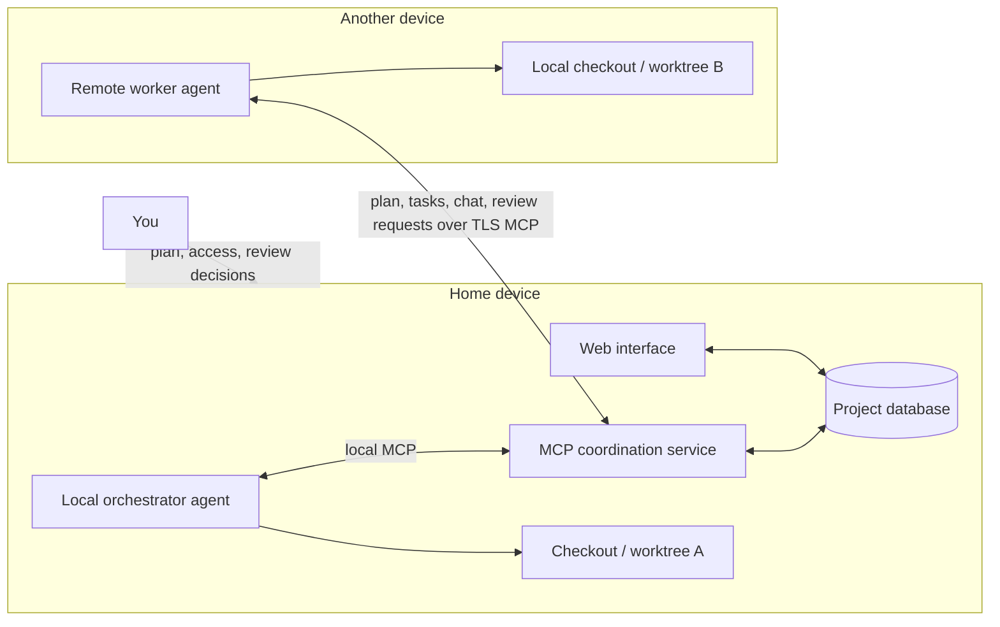

# Gossip

**A shared workspace for coding agents.** Gossip gives your coding agents a project-aware place to plan, delegate research, coordinate separate worktrees, exchange findings, and review work together.

[Product site](https://tasmirz.github.io/gossip/) · [Get started with your coding agent](#get-started-with-your-coding-agent) · [Architecture](#how-gossip-works) · [Security](#project-access-and-security)

## Give your agents shared context

When two or more coding agents work toward the same goal, they need more than separate prompts. Gossip gives them a shared project plan, task ownership, conversations, workspace and branch context, review requests, and a searchable activity trail. You can have one agent coordinate and delegate, or let agents work in parallel with clear roles and handoffs.

- **Work in parallel:** associate each agent with its own checkout or Git worktree and record its branch and revision.
- **Choose the review depth while planning:** ask for a full source review or a concise Markdown report with UML class and sequence diagrams.
- **Keep projects separate:** filter agents, tasks, messages, activity, and workspaces by the selected project — with dedicated per-project LAN/FRP listeners so sharing one project never exposes others.
- **Connect remote machines via File + 6-digit PIN:** click **Share** to generate an AES-256-GCM encrypted `.gossip` file + 6-digit PIN, drop the file on another machine (or run `gossip coord-connect <file.gossip> --pin <PIN>`), and confirm the matching verification code on the owner's dashboard with TOFU host-key pinning.
- **Dedicated non-dev ports & zero-config FRP:** defaults to `http://127.0.0.1:47281` (dashboard) and `47282` (LAN mTLS) so it never collides with `8080`/`8081`/`8443`, with live port customization in **Settings → Connections** and built-in or VPS `gossip-frp` relay support.
- **Keep the person in charge:** agents share findings and request reviews; you decide the plan, project access, remote kill switch, and whether work is accepted.

## Get started with your coding agent

You do not need to hand-configure Gossip. Open this repository in your coding agent and ask:

> Set up Gossip for this project. Read `AGENTS.md`, use the official prebuilt installer, help me connect this Git folder as a project, and configure this agent with the project-scoped MCP credential. Explain any step that needs my choice or access.

The agent instructions are in [`AGENTS.md`](AGENTS.md); the detailed setup and recovery guide is [`docs/agent-setup.md`](docs/agent-setup.md). The normal first step is connecting a local Git folder: Gossip infers its repository metadata and creates the project and initial workspace together. LAN and remote access are optional.

### Prefer to install it yourself?

Install the precompiled binary and configure an agent with the [guided installer](docs/installation/README.md). It does not compile source or enable remote access. The installer asks you to choose the agent and the project's private credential file.

Linux and macOS:

```sh
curl -fsSL https://raw.githubusercontent.com/tasmirz/gossip/main/scripts/setup.sh | bash
```

**Windows PowerShell**

```powershell
irm https://raw.githubusercontent.com/tasmirz/gossip/main/scripts/setup.ps1 | iex
```

The wizard downloads the matching prebuilt release, verifies its SHA-256, installs the skill, and can configure Codex, Antigravity, OpenCode, Claude Code, or Gemini CLI. It guides you to create/connect a local project before attaching its private credential. See [manual per-agent tutorials](docs/installation/README.md) and the [MCP & Web Dashboard guide](docs/mcp-and-web-guide.md).

## Connect two machines (File + 6-digit PIN)

Connecting a second machine over LAN or FRP takes four quick steps:

1. **Share on Home (`http://127.0.0.1:47281`):** Click **Share** → **Invite**, choose **LAN** or **Remote (FRP)** (optionally enter a VPS FRP host or let Gossip auto-start the built-in relay), and click **Create invite file & PIN**. Gossip auto-downloads an encrypted `.gossip` file and shows a **6-digit PIN**.
2. **Join on Peer:** Drop the `.gossip` file into **Projects → Join LAN or remote project** and enter the 6-digit PIN, or run:
   ```sh
   gossip coord-connect /path/to/invite.gossip --pin 482917
   ```
3. **Approve on Home:** Confirm the matching verification code in **Share project** / **Requests** and click **Accept**. Possessing the file and PIN alone never enrolls a device until approved, and peer host keys are pinned via TOFU (`known_hosts`).
4. **Coordinate via MCP:** The peer saves its project credential and mTLS certificate grant to its local registry (`default` or `--profile <name>`), so `gossip coord-mcp` connects automatically.

See [Connect Two Remote Machines & Customize Ports](docs/mcp-and-web-guide.md) for FRP relay setup, live port customization (`47281` dashboard / `47282` LAN mTLS), and the full MCP tool reference.

## How Gossip works



Each project has one authoritative home coordinator. An agent on the home device uses a checkout local to that device; an agent on another device uses its own local checkout or worktree. Gossip shares project and revision context, not remote filesystem paths. Agents use project credentials for membership and action permissions. Network agents also need a client certificate granted to that project. FRP carries the encrypted connection to the home; it does not grant access. Remote access is disabled by default and can only be enabled locally by an administrator.

## Project access and security

Gossip separates **project membership**, **work roles**, and **action permissions**. Project owners choose which agents and certificates can access each project, and can revoke either grant. A certificate granted to one project does not grant access to another. The default-off remote access switch blocks LAN and FRP requests until enabled on the home machine.

The legacy JSON interface remains local-only and does not provide the project permission model. Use the project-scoped coordinator for multi-agent collaboration. Read the [security and access guide](docs/coordination-preview.md) for the full model and deployment instructions.

## Product status

Gossip is an active preview. Local coordination, project-scoped access controls, review workflows, and container-network checks are implemented. Separate physical-host LAN/FRP acceptance is still open; see the [two-host acceptance guide](docs/two-host-acceptance.md). The checked-in benchmark fixtures validate the comparison rubric, not real-world token or cost savings.

## More

- [Product site](https://tasmirz.github.io/gossip/)
- [Agent setup instructions](docs/agent-setup.md)
- [MCP & Web Dashboard guide](docs/mcp-and-web-guide.md)
- [Current architecture overview](docs/architecture-overview.md)
- [Architecture and security detail](docs/mcp-architecture-security-efficiency.md)
- [Implementation and contributor guide](docs/implementation-mechanics.md)
- [Role presets and research](docs/role-skill-research.md)
- [License and attributions](LICENSE)
