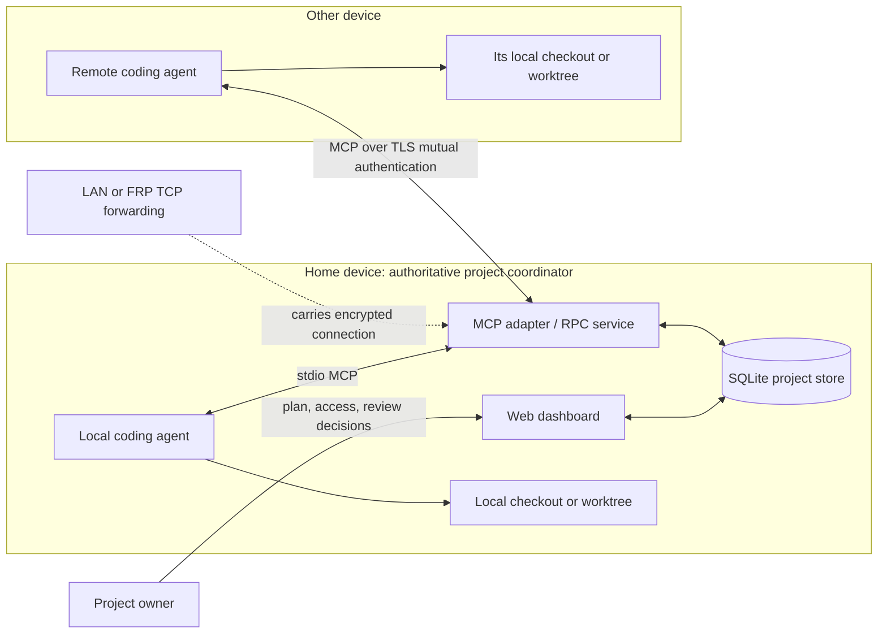
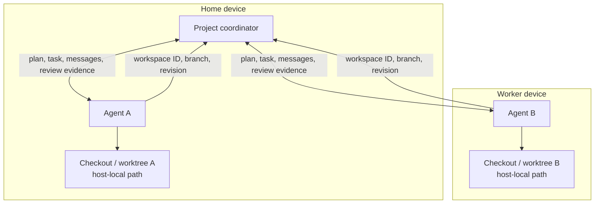
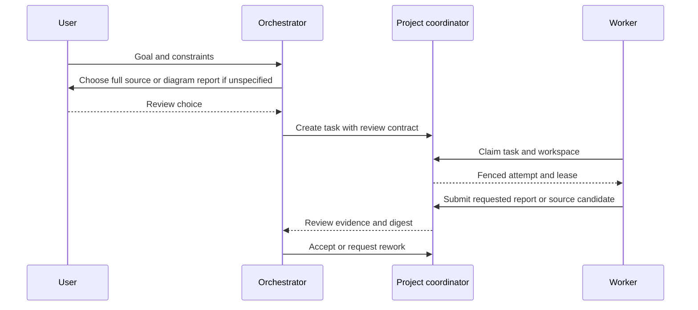

# Gossip architecture

Gossip is a project-scoped coordination service for coding agents. Each project has one authoritative home coordinator. Agents run as local MCP clients on their own machines and communicate with that coordinator. Git worktrees remain on the devices where they are checked out; the coordinator stores workspace identity and revision metadata, not remote filesystem access.

## System context



The local path uses stdio MCP or a private Unix socket. Remote adapters connect to the home over TLS 1.3 mutual authentication. FRP can forward TCP to the TLS listener; it does not authenticate users, grant project access, or replicate project data. Only the home coordinator accepts authoritative writes. Offline adapters may retain bounded read snapshots and queue supported idempotent requests for delivery to that home.

## Host and workspace model



A workspace record associates an agent's checkout with a project, repository, node label, branch, observed head, and dirty-state summary. The absolute local path is private to its owner. A remote agent operates on its own checkout; Gossip does not mount or copy that filesystem. Agents on one device can register and use checkouts available on that device. The owner chooses whether workers share one checkout or use separate worktrees, and the UI displays the registered workspace context so that the choice is visible.

## Project access and authorization

The three controls have different jobs:

| Control | What it proves | Scope |
| --- | --- | --- |
| Project credential | The caller is an enrolled project principal | One project |
| Work role and action grants | Which coordination actions the principal may perform | One project, optionally one task |
| Client certificate grant | The verified network client is admitted to the project | One project and certificate fingerprint |

For a network request, the home first requires remote access to be enabled, then validates the TLS client chain and project certificate grant, then authenticates the project credential, and finally checks the action permission. A valid certificate does not enroll a project member; a project token does not bypass certificate scope. Membership, role/action grants, and certificate grants can be revoked independently. New and migrated databases default to remote access disabled. Only local CLI or private Unix socket administration can change that host-wide switch.

```mermaid
sequenceDiagram
  participant Agent as Remote MCP agent
  participant TLS as TLS listener
  participant Gate as Remote access switch
  participant Home as Home coordinator
  Agent->>TLS: TLS 1.3 with client certificate
  TLS->>Gate: Request
  alt remote switch disabled
    Gate-->>Agent: 503; no RPC or project lookup
  else enabled
    TLS->>Home: verified certificate + project request
    Home->>Home: check certificate grant for project
    Home->>Home: authenticate project credential
    Home->>Home: authorize action grant
    Home-->>Agent: scoped result or 401/403
  end
```

## Planning and review flow

The orchestrator creates tasks against a published project plan. During planning, if no review type is specified, it asks the user to choose one of two contracts:

- **Full source review:** a candidate identifies its task attempt, workspace baseline, source evidence, and digest for the orchestrator's review.
- **Diagram report:** a Markdown report with required narrative sections, UML class and sequence diagrams, and the planned coverage. This supports an inexpensive architecture-first review; it does not imply that source inspection has happened.

Workers claim tasks with a lease and attempt number. The coordinator fences stale attempts, records reports and candidates as evidence, and lets an authorized reviewer accept or request rework. Presence reports that an authenticated MCP adapter is alive; it does not claim the coding model is running or executing a task.



## Main code map

| Area | Main source |
| --- | --- |
| CLI, dashboard, daemon, TLS startup | `cmd/gossip/coord.go` |
| SQLite schema, migrations, project lifecycle | `pkg/coord/store.go` |
| Membership, roles, action permissions | `pkg/coord/permissions.go`, `pkg/coord/roles.go` |
| Local and remote RPC clients, TLS enforcement, kill switch | `pkg/coord/remote.go`, `pkg/coord/remote_methods.go`, `pkg/coord/local_rpc.go` |
| Project MCP tools and adapter heartbeat | `pkg/coord/mcp.go`, `pkg/coord/presence.go` |
| Workspaces, Git observations, recognition | `pkg/coord/workspace.go`, `pkg/coord/git.go`, `pkg/coord/recognition.go` |
| Task state, leases, report contracts, candidates | `pkg/coord/work.go`, `pkg/coord/lifecycle.go`, `pkg/coord/report_contract.go`, `pkg/coord/candidate.go` |
| Offline snapshots and outbound delivery | `pkg/coord/offline_cache.go`, `pkg/coord/outbox.go`, `pkg/coord/report_outbox.go`, `pkg/coord/review_outbox.go` |
| Current dashboard and static assets | `pkg/coord/web.go`, `pkg/coord/ui/` |
| Legacy local-only JSON dashboard | `pkg/web/server.go` |
| Portable MCP client examples | `examples/mcp-clients/` |
| Portable coding-agent skill | `skills/gossip/SKILL.md` |

For detailed historical tool sequences and source-level mechanics, see [MCP architecture, security, and efficiency](mcp-architecture-security-efficiency.md) and [implementation mechanics](implementation-mechanics.md). Those documents include the retired legacy MCP operation inventory and should not be used as current client configuration.
