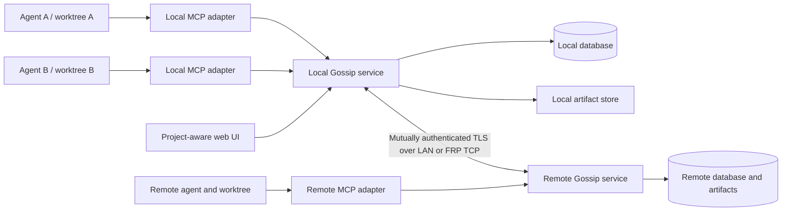
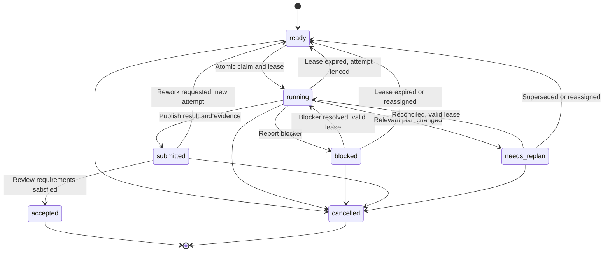
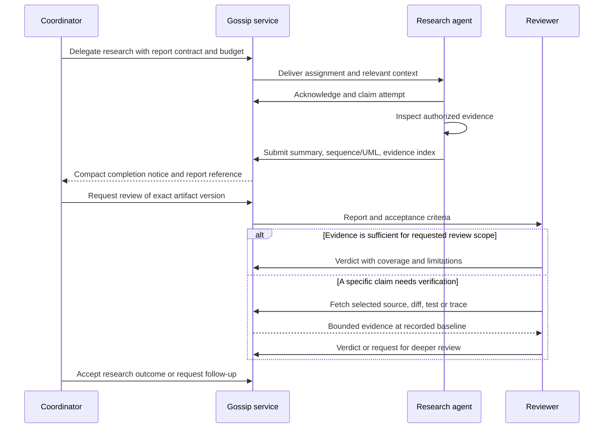

# Gossip redesign plan

Status: finalized design; implementation is in progress. This status audit is based on the current source and tests in this checkout. A capability is marked implemented only where there is a corresponding implementation and a focused verification path; phase acceptance remains open until its complete end-to-end scenario is verified. Current user-facing capabilities and limits are tracked in [coordination preview](coordination-preview.md).

## 1. Product contract and scope

Gossip connects coding agents across local worktrees, LAN machines, and remote machines reached through FRP. Users give agents a shared goal, choose how they collaborate, and follow their conversations, assignments, research, changes, and verification in a project-aware web interface.

Support both a coordinator delegating to workers and equal peers collaborating in parallel. A coordinator can delegate research, request a report or sequence/UML diagram, inspect a compact result, ask follow-up questions, request targeted source inspection, and authorize the next step. Roles and review depth can change as work progresses.

The default experience has three steps: connect agents, select a project and goal, and start collaborating. Discovery, connection maintenance, delivery retries, and routine heartbeats run outside model turns. Advanced controls are available through settings without becoming prerequisites for ordinary use.

The initial design findings were based on:

- [MCP architecture, security, efficiency, and tool sequences](mcp-architecture-security-efficiency.md).
- [Implementation mechanics and source map](implementation-mechanics.md).

The implementation-status audit below has since checked the current source and package tests. It is not a performance benchmark or online skill evaluation. Source links in the design sections remain starting points; current code and focused tests are authoritative for behavior.

## Current implementation status

The redesign is not complete. The selected deployment model is one authoritative home coordinator per project, with authenticated LAN/FRP clients and bounded local caches/outboxes. The user selected this single-home model; multi-master coordinator federation is outside this release.

| Phase | Current evidence | Status and remaining acceptance work |
| --- | --- | --- |
| P0: contracts and containment | The SQLite service authenticates project principals, enforces project-scoped action grants, requires the project credential on every operation, and checks an additional project certificate grant for TLS network access. MCP project creation is isolated in a create-only stdio server. Local bootstrap checks the API key against a SHA-256 digest stored in the selected coordinator database; `TestLocalBootstrapKeyMustMatchConfiguredDigest`, `TestCoordBootstrapKeyConfiguresLocalDatabase`, and the local-socket bootstrap case verify wrong-key rejection. Remote creation additionally requires a CA-verified TLS client certificate and the configured create-only key; `TestRemoteMutualTLSResearchHandoff` verifies wrong-key denial, bootstrap-key inability to read project data, durable prepared-credential idempotency, and atomic grant of the caller certificate to the new project. Subsequent actions require the saved per-project owner credential and that project’s certificate grant. Dashboard API responses distinguish disconnected/revoked credentials (401) from valid sessions denied by role or certificate scope (403); `TestWebProjectAccessErrorsDistinguishMissingCredentialFromRoleDenial` and `TestWebDistinct401Vs403StatusReturnsOnAccessLoss` cover the browser-facing distinction, including 403 after `project.read` revocation while a credential remains valid, frontend preservation of the session on 403, and expiry only on 401; the membership-only validation operation returns no project data and is also exercised over TLS. Revoking `project.read` also hides project action grants immediately; `TestProjectReadMessagingClaimAndSubmitAreSeparateGrants` checks the permissions endpoint. `TestProjectReadRevocationBlocksAllProjectReadSurfaces` covers member, task, report, candidate, workspace, message, event, presence, integration, archive, and cache-sync reads after revocation. The local remote kill switch is enforced via SQLite table `remote_access_control` (defaulting `enabled=0` for new and upgraded databases). Request-by-request pre-auth gating blocks network RPC (including create-only bootstrap and FRP-forwarded traffic) and remote HTTPS dashboards with HTTP 503; plain HTTP loopback dashboard access and private Unix domain socket administration remain functional. `remote.access.status` and `remote.access.set` are strictly rejected over TLS RPC (HTTP 401) and restricted to the local socket or `coord-remote` CLI. Regression tests in `remote_test.go` (`TestRemoteMutualTLSResearchHandoff`, `TestRemoteBootstrapKillSwitchDisabled`), `web_test.go` (`TestWebRemoteAccessKillSwitchRejectsHTTPS`), `coord_test.go` (`TestCoordRemoteCLI`), and `store_test.go` (`TestStoreMigrationCreatesRemoteAccessControlTableAndDefaultsDisabled`) verify default-off state, database upgrade migration, UPSERT recovery, immediate block on running listeners, and CLI administration. Legacy HTTP tunnel activation/generation and secret transfer are disabled, and legacy HTML UI controls have been replaced with secure mTLS/FRP guidance. Legacy MCP remote-registration tools are removed; `TestMCPServerInitializationAndDynamicRoles` asserts the tools are absent. The legacy CLI MCP transport is retired outright; `TestLegacyMCPEntryPointsAreRetiredRegardlessOfOptIn` checks no-argument, `mcp`, `serve`, and flag-style invocations even with the former opt-in set. The remaining local-only web handler rejects non-loopback Host values and cross-origin requests to reduce DNS-rebinding and browser-CSRF exposure. `TestLegacyDashboardRejectsUntrustedBrowserOrigins` covers the Host and Origin boundaries. Migration audit and archive flows are implemented. The repository's real `.local/gossip` fixture passed dry-run and warning-reviewed import into a disposable project database; owner readback returned exactly two archived messages and the audited counts of one agent, one artifact, and one task. The checked-in MCP client examples launch `coord-mcp` with a per-project credential and expose an optional, separate `gossip-project-bootstrap` server using only a private API-key file path; `TestMCPClientConfigsExposeCreateOnlyBootstrapByPrivateKeyPath` checks that each supported template keeps bootstrap separate and does not embed the key. MCP-driven creation remains limited to this create-only server. | Project-scoped service containment, certificate revocation, retired legacy remote-registration surfaces, the remote kill switch, and rejection of the unscoped legacy MCP transport are tested; the real legacy fixture also passes dry-run/import/readback. P0 remains partial because the legacy JSON store and dashboard do not implement project membership/action permissions or central policy checks across every old mutation; treat those local surfaces as outside multi-agent access control and use the project-scoped service for collaboration. |
| P1: local collaboration | Project plans, tasks, workspaces, messages, events, leases, project discovery hints, and the dashboard are implemented. `TestProjectRecognitionOnlySearchesConnectedProjects` covers an ambiguous remote mapped in two projects and excludes an unconnected third project; `TestConcurrentClaimsAcrossConnections` and `TestWorkspaceBaselinesAndPrivacy` cover atomic claims and per-owner workspace paths. `TestTwoAgentsSharePlanChatAndRequestBothReviewTypesAcrossWorktrees` exercises the combined two-agent backend workflow, separate workspaces, plan acknowledgment, private direct chat, claim/submit/review, and owner acceptance of both review deliverables. `TestMCPIntegrationRecordsDivergentSameBranchCheckoutsAtCombinedRevision` verifies reconciliation of separate clones on the same branch name and records checks against the merged revision. The local dashboard now starts with **Connect a code folder**: it infers repository name, sanitized remotes, branch, head, and dirty state, then atomically creates the project, repository, and workspace; the owner credential downloads and the project is selected. `TestLocalProjectSetupCreatesSessionAndReturnsCredential` verifies inference, workspace association, session, and credential response. `TestProjectBootstrapMCPCreatesInferredWorkspaceAndPrivateCredential` verifies the create-only MCP tool saves a mode-0600 owner credential before creation, supports idempotent retries, and never returns its token. `TestLocalDaemonCredentialIsolationAndConcurrentClaims` also verifies the same local-folder bootstrap over the private socket. A separate browser repro verified that a dashboard restart expires its in-memory session; the UI clears stale project data and returns to credential reconnection instead of leaving a stale project view with an unauthorized toast. The running dashboard was also checked after the credential-versus-checkout onboarding clarification: Overview and Workspaces navigation change views while disconnected, and the workspace view directs users to create/connect a project before registering a checkout path. A disposable two-browser run then connected distinct owner and worker credentials in separate browser origins, registered separate Git clone workspaces, shared and acknowledged one plan, created/claimed a research task, exchanged direct chat, and showed the worker's review request in the owner Activity feed. The owner workspace view showed workspace identity/revision without disclosing the other principal's local path. | Local two-agent/two-worktree collaboration and live dashboard navigation, activity refresh, and workspace privacy are verified in a single-host browser workflow. Multi-machine execution remains part of P4 acceptance. |
| P2: delegation and reports | Agents can create/assign research tasks. Task contracts require an explicit review type during planning. Workers can request orchestrator review for either `full_code` or `diagram_report`; the MCP adapter captures the active registered worktree from the attempt's recorded commit, including tracked and non-ignored untracked changes, and full-code events pin the candidate ID/digest/baseline for paged retrieval. `TestRemoteMutualTLSResearchHandoff` covers both remote review types, report/evidence retrieval, and owner acceptance of each exact report digest over mutual TLS; `TestMCPFullCodeCaptureUsesAttemptWorktree` covers capture from the registered worktree. Diagram reports require populated narrative, UML class and sequence sections plus planned coverage. `TestTaskAPIAndUIExposePlannedReviewContract` verifies the task API returns the planned review contract and the task-detail renderer reads `report_contract`, showing the correct full-code or UML report choice to agents. The disposable two-browser workflow requested a planned `diagram_report`, showed the attempt baseline and report digest, rendered both UML diagrams, let the owner request targeted rework, and accepted the corrected report. | Both review paths are implemented and package-tested; the diagram-report workflow is also verified in the browser, including targeted rework and exact report acceptance. Review requests notify the orchestrator; they do not launch reviewers or prove semantic correctness. |
| P3: policy and configurable workflow | Project action grants, editable roles, settings, budget reservations, leases, presence, and integration records are implemented. Authenticated MCP heartbeats report adapter capabilities separately from optional host-configured capabilities; the UI labels host reports as unverified metadata. Adapter presence starts only after successful MCP initialization; `TestMCPAdapterHeartbeatEndsOnClose` verifies the adapter is offline before initialization, online after the handshake, and offline again after close. Presence also displays the MCP client name/version reported in initialization as untrusted recognition metadata; `TestRemoteMutualTLSResearchHandoff` verifies these fields survive authenticated TLS RPC, and `TestMCPClientPresenceColumnsMigrateExistingDatabase` covers upgrades. `TestAgentPresenceCapabilitiesAreAuthenticatedLabeledAndReplaceable`, the adapter heartbeat test, and remote mutual-TLS handoff coverage verify replacement, provenance, and transport. Tasks can require an owner-assigned dynamic role and/or a bounded set of supported capabilities. Assignment checks role; claim checks role plus all required capabilities on one recent authenticated session. The dashboard filters eligible assignees by both constraints; `TestTaskRequiredCapabilitiesNeedOneLiveAuthenticatedSession` covers missing, split-session, and complete reports, while `TestTaskAPIAndUIExposePlannedReviewContract` checks the API/UI contract. The Agents view distinguishes an authenticated MCP heartbeat from execution state. `gossip_usage` accepts one immutable, idempotent per-attempt summary with provider/model, token counts, integer-micros cost, currency, and provenance (`provider_reported`, `host_reported`, or `estimated`); Settings shows per-project totals. Usage tests cover ownership, project isolation, and retry safety. The periodic-check runner waits for its goroutine to exit on Stop, covering a race found by the race suite. | Partial. Role and claim-time capability eligibility are implemented. Host capability auto-discovery, managed process launch/interruption, trusted runtime enforcement, and provider-verified usage remain open. Host capability labels remain configured and unverified; usage remains self-reported. Do not present presence as execution management or usage totals as authoritative billing. |
| P4: single-home remote coordination | Mutual TLS, project-specific membership and certificate grants, remote MCP, bounded read snapshots, per-project outboxes, and FRP TCP reachability are implemented. `TestRemoteMutualTLSResearchHandoff` verifies both review types, exact report/source retrieval, owner acceptance, project credentials and certificate grants over TLS. `TestMCPQueuesReportAndSafelyRetriesLostHomeResponse` covers a lost acknowledgment and idempotent delivery; outbox and cache restart tests cover durable local state. The FRP 0.72.0 integration subtest verifies tunnel reconnect, remote invitation, project isolation and certificate revocation. On 2026-11-08, `scripts/coordination-container-network-smoke.sh` passed across separate Docker network namespaces: disabled kill switch returned 503, authorized owner and worker calls returned 200, an ungranted certificate returned 403, a worker credential on another certificate-granted project returned 401, certificate revocation returned 403, and disabling access again returned 503. The FRP 0.72.0 integration subtest was re-run on 2026-11-08 using the official Linux amd64 release archive after verifying its published SHA-256. | Partial. All recorded network tests used one physical host. The [two-host acceptance runbook](two-host-acceptance.md) now defines the full P2 workflow between separate machines, including disconnect/reconnect, process restart, project/certificate revocation and both review types. Its execution record is still required before P4 can be marked complete. Multi-master replication and authority handoff are explicitly outside this release. |
| P5: integration and complete UI | Revision-linked integration records, task search, all-project overview, saved filters, report rendering/download, project-scoped access UI, full-screen evidence controls and paged audit history are implemented. Browser acceptance reconciled two independent clones on `main`, recorded checks against the exact combined SHA, kept a second project isolated, and verified saved filters persist across views and tabs. `TestParallelMCPFullCodeCandidatesReviewedThroughDashboardAPI` exercises two authenticated MCP workers and owner review of each exact candidate/report digest. A disposable two-browser workflow created a planned full-code task, denied the worker access to a second project, acknowledged the plan, claimed a registered Git worktree, captured a real source diff through MCP, requested review, and submitted a report. The owner opened the report and pinned diff, verified baseline/digest/content, expanded/restored the evidence, and accepted the report; the task displayed ACCEPTED. Audit history loaded 102 retained events over two pages. | Complete. Browser and API evidence cover the P5 acceptance gate, including combined-revision checks, project isolation, filter persistence, and full-code handoff/review. |
| P6: measured optimization and extensions | Settings expose summary targets and concurrency/lease controls. The six editable Gossip role presets now return provenance and HTTPS first-party skill/orchestration guidance links, which the UI preview displays; `TestWorkRolePresetsAreVersionedAndIncludeHandoffBoundaries` checks each preset has a source. The current skill catalog status and trust/compatibility limits are documented in [role and skill research](role-skill-research.md). | Not complete. The role duties are Gossip-authored candidates, not evaluated or declared “best”; representative task evaluations across supported agent hosts remain open. There are also no representative cost/latency/token benchmarks demonstrating savings. |

On 2026-11-08, `go test -race ./...`, the focused project-access and remote-review tests, `go vet ./...`, and `git diff --check` passed in this checkout. These implementation checks do not substitute for the open separate-machine remote acceptance and remaining phase gates above. Keep README/release claims aligned with this table until those gates are verified.

The legacy JSON MCP CLI transport and its schema exporter are retired regardless of the former `GOSSIP_ENABLE_LEGACY_MCP` opt-in. `TestLegacyMCPEntryPointsAreRetiredRegardlessOfOptIn` checks no-argument, `mcp`, `serve`, flag-style, `export-mcp`, and `mcp-export` invocations. Installers defer MCP configuration until a project-scoped credential exists. The legacy store itself still has no project membership/action policy and is not a supported multi-agent access-control boundary.

## 2. Findings that drive the redesign

| Priority | Documented issue | Required change |
| --- | --- | --- |
| Critical | Caller-supplied agent IDs, senders, and roles; conditional role checks; empty role accepted in some authorization paths. | Authenticate sessions and derive identity server-side; authorize every operation against explicit grants. |
| Critical | Web listener uses all interfaces and plain HTTP; Basic Auth is optional and incomplete configuration disables it. | Loopback by default; authenticated browser sessions; authenticated and encrypted remote connections; fail closed. |
| Critical | Vault sends a decryption passphrase with ciphertext and can return completion without confirmed transfer. | Remove the existing transfer mechanism from the normal collaboration path; use local secret references and a separately designed secret-delivery capability later. |
| High | JSON containers, whole-log scans and rewrites, advisory locking, unlocked load/save paths, and partial side effects. | Transactional state, indexed reads, durable events and outbox, idempotent commands, explicit partial failures. |
| High | Graph indexing saves outside the store lock. | Isolate derived indexing from authoritative collaboration state; publish revision-specific indexes atomically. |
| High | Task creation accepts unknown prerequisites and statuses are not universally constrained. | Enforce task states, valid dependencies, atomic claims, attempt ownership, and revision checks centrally. |
| High | MoE dispatch creates tracks without starting agents; parallelism is recorded without enforcement. | Separate assignment, delivery, acknowledgment, execution, submission, and acceptance; enforce configured limits. |
| High | Federation documents remote queries and declared peers without establishing reliable shared-plan coordination. | Define project authority, scoped replication, reconnect behavior, durable handoffs, and duplicate suppression. |
| Medium | Optional guardrail checks and SOP artifact-presence checks can appear stronger than their actual enforcement. | Apply policy in the shared application service and show precisely what each review verified. |
| Medium | Large overlapping tool surface; repeated status and event scans. | Small default MCP surface, bounded deltas and reports, daemon-managed transport work. |
| Medium | Graph entries can become stale and package IDs can collide. | Revision-aware derived data and stable repository-qualified IDs; graph features remain optional. |

Evidence: [security and efficiency](mcp-architecture-security-efficiency.md#security-properties-and-limitations), [storage](implementation-mechanics.md#storage-identity-and-consistency), [tasks](implementation-mechanics.md#tasks-and-derived-lists), [events and MoE](implementation-mechanics.md#events-cron-and-moe), and [federation/vault](implementation-mechanics.md#tunnel-federation-and-vault).

The initial source documents did not establish complete plan acknowledgment, code-baseline, or stale-result behavior. The current coordination implementation now records plan acknowledgments, binds submitted reports to a claimed workspace baseline, and fences superseded attempts; those mechanisms still need end-to-end verification as called for in P1/P2 acceptance gates.

## 3. Architecture decisions

Use one local Gossip service per OS user and machine, with a thin MCP adapter for each connected coding-agent host. Multiple worktrees connect to this service. Implement the service as one Go application with internal modules; avoid separately deployed subsystems initially.



| Internal module | Owns |
| --- | --- |
| Identity and policy | Node pairing, user/agent sessions, project membership, permissions, revocation. |
| Collaboration | Projects, goals, plan revisions, tasks, attempts, role assignments, decisions, conversations. |
| Reports and evidence | Immutable artifacts, report contracts, coverage, review verdicts, source/commit references. |
| Runtime adapters | Host capability discovery, wake-up integration, managed execution, cancellation, usage collection. |
| Persistence and events | Transactions, indexes, durable outbox/inbox, cursors, replay, retention and snapshots. |
| Federation | Peer transport, authorized project subscriptions, routing, synchronization and delivery receipts. |
| Presentation | MCP/CLI/HTTP adapters and web views over the same application operations. |

All mutations pass through the same authenticated application boundary. HTTP, CLI, MCP, and federation must not implement competing task rules or bypass policy through direct manager/filesystem writes.

Use SQLite as the initial transactional store, local to each service. Never share a database file over a network filesystem. Commit domain state, corresponding events, and outgoing delivery records in one transaction. Use optimistic resource versions for competing updates. Expensive work runs outside write transactions.

Store large artifacts as immutable, content-addressed objects. Verify uploads and durably stage bytes before committing their metadata; garbage-collect abandoned uploads. Markdown boards and reports are generated views. Failed rendering is visible and retryable without undoing successful domain operations.

No full event-sourcing framework is required: relational current state plus a durable event/outbox history is sufficient. Database permissions, backups, and private keys are local OS responsibilities as well as application concerns.

## 4. Domain model and invariants

| Object | Contract |
| --- | --- |
| Node | One authenticated Gossip service installation with a private key and stable node ID. |
| Principal | A human or agent identity with explicit project-scoped grants. |
| Project | Shared collaboration ID, membership, settings, repositories, and one authoritative home node. |
| Repository | Explicit repository identity within a project; remote URLs are recognition hints. |
| Workspace | A registered checkout/worktree on one node, with branch label, base/head commit, and dirty-state observation. |
| Agent | Reusable collaboration identity and display name; independent of model/provider choice. |
| Session | An authenticated connection/run for an agent, bound to allowed projects and workspaces. |
| Goal | Desired outcome, constraints, and measurable acceptance criteria. |
| Plan revision | Immutable version of scope, interfaces, dependencies, and decisions; one current revision per plan. |
| Task | Bounded research, design, implementation, review, verification, or integration work. |
| Attempt | One execution of a task, with agent/session, plan baseline, workspace baseline, lease and fencing number. |
| Report contract | Requested questions, format, evidence coverage, output budget, review requirements and revision. |
| Artifact | Immutable report, diagram, patch, log, or evidence with author, provenance, hash, and revision links. |
| Review | Verdict against specific artifacts/code revisions, with review mode, coverage and limitations. |
| Role assignment | Versioned responsibility for a project/task/time window; separate from permissions. |

Mandatory invariants:

1. Project/resource IDs and authenticated principals determine authorization. Display names, branch names, roles, paths, and message text never do.
2. Every task references a goal and plan revision; every attempt records its execution baseline.
3. Exactly one current exclusive attempt may own a task at its project authority. Expired/superseded attempts cannot mutate its authoritative outcome.
4. Submitted work and accepted work are different states. Acceptance records which criteria and evidence passed.
5. Review acceptance is bound to exact artifact hashes and code revisions. Later changes invalidate the affected coverage.
6. Project membership gates every query, mutation, event, search result, artifact fetch, count, and export.
7. Transport retries cannot repeat a committed domain mutation. Command IDs are scoped to principal/project and payload; reused IDs with different payloads fail.
8. Configuration, role, plan, and policy changes are versioned and attributable.

Project access is an explicit per-project allowlist: an administrator selects a project before enrolling a person or agent, and access to one project never grants access to another. The UI must show the selected project name and stable ID beside every membership, permission, and certificate access control before an owner acts, and make each project's members and revocations visible in that project's context. LAN and remote clients using the network service both authenticate to the project they request; TLS clients additionally need a client-certificate grant for that project. Local IPC uses the OS-protected socket boundary and the project credential. A role controls permitted actions only after project membership has been established.

## 5. Project and agent recognition

On connection, adapters submit trusted host observations where available: workspace location, Git common directory/worktree association, repository remote hints, branch, head commit, dirty status, host type, and supported runtime capabilities. The service issues or resumes the authenticated session. Model/provider names are optional metadata and show whether host-reported or self-reported.

Recognition follows this order:

1. An existing explicit workspace-to-project binding.
2. An existing local repository binding, including other worktrees of the same registered repository.
3. A suggested match using normalized remote URLs and repository metadata.
4. A one-time project selection when the match is ambiguous or new.

Suggestions never silently grant project membership. Forks, URL aliases, mono-repos, submodules, renamed remotes, and copied folders need explicit mappings when ambiguous. Project IDs are created/enrolled, not derived solely from a filesystem path or remote URL.

An agent can participate in multiple projects through explicit session bindings. Its current task/project is visible; it cannot accidentally send a message to whichever project another browser tab selected. Resume credentials, rather than a supplied agent name, establish continuity after restart.

Discovery only inspects configured local workspace roots and connected/enrolled peers. Do not crawl the entire filesystem or LAN by default. Show source and last-observed time for discovery information. Distinguish connected, idle, working, blocked, stale, disconnected, and unknown execution status.

## 6. Shared goals, plans, and worktrees

Task work contracts include outcome, scope/exclusions, acceptance criteria, prerequisites, interface agreements, expected deliverables, plan revision, workspace baseline, required evidence, and resource limits. Creation rejects missing/self/cyclic dependencies. State transitions reject invalid statuses and unauthorized operations.

Agents acknowledge the relevant plan revision before taking work. Plan changes use compare-and-swap against the current revision. The authority emits a compact delta and identifies affected tasks. Unaffected work can continue; affected attempts enter `needs_replan` until acknowledgment or explicit reconciliation.

Default task lifecycle:



Dependencies determine readiness. Waiting tasks are represented as blocked until prerequisites are accepted. A submitted predecessor does not automatically unblock dependent implementation. Research tasks may explicitly depend on a proposal artifact when the plan permits exploratory work.

Leases are renewed by adapters, not model turns. Each reassignment increases a fencing number. A stale attempt can upload a candidate result for reconciliation, but cannot complete, accept, or replace current work. Local timeout observations never create new authority.

Prefer one writer per worktree. Shared checkouts require explicit coordination and carry an overlap warning. File/component reservations are advisory unless a managed sandbox enforces them. All attempts track their base/head and relevant dirty snapshot or patch digest; a commit ID alone does not identify uncommitted work.

Agents working on different revisions of the same branch share the goal and plan while retaining distinct execution baselines. Code moves through explicit commits, patches, or an approved source-transfer path. Integration creates an identifiable candidate revision and records checks against that combined revision. Chat and plan synchronization do not synchronize Git content.

## 7. Orchestration, research, and delegation

Research is a first-class task type. A coordinator can ask one agent to map current behavior, another to investigate alternatives, and a reviewer to compare their evidence before implementation starts. Sequential and parallel execution use one dependency DAG.

Supported collaboration patterns:

| Pattern | Example |
| --- | --- |
| Sequential | Research current behavior -> design proposal -> implementation -> verification. |
| Parallel | Two agents research separate subsystems, then a synthesis task compares their findings. |
| Coordinator/workers | Coordinator assigns bounded changes and reviews compact result packets. |
| Equal peers | Agents claim separate ready tasks and resolve shared interfaces through task-linked threads. |
| Escalation | Worker requests a specialist or deeper review with a specific question and budget. |

`delegate` creates a task/subtask with a report contract, target agent or capability selector, scheduling preference, and limits. Delegation never grants new filesystem, network, project, or administration privileges. Subdelegation requires an existing grant and is bounded by depth, concurrency, total descendants, deadline, and parent budget. Child budgets reserve against the parent envelope; parallel children cannot each spend the full parent allowance.

The scheduler enforces task and runner capacity, not just declared `max_parallel`. Eligible agents are selected using capabilities, availability, project membership, role preferences, workspace suitability, and cost preferences. A coordinator may choose explicitly within the same constraints. No hidden model call is needed for basic scheduling.

Parent tasks become ready when required child outcomes are accepted. Questions, clarifications, and report revisions can reopen work without losing previous artifacts. Deadline expiry, cancellation and retry behavior are explicit. Cancelling a parent prevents new child dispatch and requests cancellation of active children; uninterruptible external agents show cancellation pending and their attempts are fenced.

Loop prevention includes a shared interaction budget, delegation-depth limit, repeated-question detection, bounded debate rounds, and escalation to a human when progress stalls. Research reports can recommend decisions but cannot silently change the active plan or project settings.

### Example work order

The following is an illustrative typed contract, not an already implemented API:

```json
{
  "project_id": "project-gossip",
  "goal_id": "goal-reliable-handoffs",
  "plan_revision": 4,
  "operation": "delegate",
  "kind": "research",
  "target": {"capability": "go-source-analysis"},
  "title": "Explain task claim and reconnect behavior",
  "questions": [
    "What identifies the caller?",
    "Where is ownership committed?",
    "What happens after a timeout, duplicate request, or crash?"
  ],
  "report_contract": {
    "formats": ["markdown", "mermaid_sequence", "mermaid_state"],
    "review_mode": "report_first",
    "coverage": ["success", "authorization_failure", "retry", "crash", "stale_attempt"],
    "require_source_refs": true,
    "require_revision": true,
    "require_unknowns": true,
    "summary_token_target": 800,
    "inline_source": "none"
  },
  "limits": {"max_parallel": 2, "max_delegation_depth": 1},
  "depends_on": []
}
```

The worker inspects authorized sources/tools as needed. The coordinator initially receives the requested report and evidence references. Follow-up retrieval and review use those references and the recorded baseline.

## 8. Report contracts and configurable review depth

Provide reusable report presets with per-task overrides:

| Preset | Default contents |
| --- | --- |
| Research brief | Questions, findings, primary sources, alternatives, uncertainties and recommendation. |
| Sequence review | Actors, entry points, call sequence, state writes, authorization, error/retry paths and source references. |
| Architecture/UML review | Component/class relationships, interfaces, ownership boundaries, state model and invariants. |
| Change summary | Outcome, changed revisions, acceptance criteria, tests/evidence, risks and remaining work. |
| Verification report | Claim-by-claim checks, environment, results, failures, coverage and verdict. |

Render Mermaid sequence, class, state and flow diagrams in the first version. Preserve editable diagram source alongside the rendered view. Label diagram type precisely; Mermaid supports useful UML-style views without requiring a remote rendering service. Add other renderers later only if needed.

Every report envelope records task/attempt ID, plan and contract revision, author, repository/workspace baseline, observation time, evidence references, coverage, confidence/limitations, and superseded artifacts. For research from external sources, record source URL/title, retrieval time, publication/version where known, and claim associations. External research tools remain independently permissioned and capability-dependent.

Source-derived diagrams map important edges and claims to file/symbol/line or immutable evidence references at a recorded revision. Include conditional calls, failure and retry paths, transaction boundaries and side effects relevant to the question. Do not present a static sequence as an observed runtime trace. Trace-derived diagrams identify the actual captured run.

Review modes:

| Mode | Reviewer initially receives | Typical next action |
| --- | --- | --- |
| `summary` | Compact result and evidence index. | Accept a low-risk research deliverable or ask a specific follow-up. |
| `report_first` | Requested Markdown/sequence/UML report and coverage. | Compare behavior to the plan; retrieve selected evidence if uncertain. |
| `targeted_source` | Report plus selected symbols, diffs, tests or trace segments. | Verify sensitive claims and boundary behavior. |
| `full_source` | Paged access to the complete declared review scope. | Perform comprehensive review without forcing all source into one response. |

Default to `report_first` for research/design and compact summaries for routine progress. The project defines minimum code-review requirements. Security-sensitive policy, identity, destructive operations, and authority changes can require targeted or full source review under that policy. An authorized user can edit the policy; an agent cannot lower it by changing its report request.

Review mode describes inspection depth, not correctness certification. Accepting a research report does not accept an implementation. A report-only code decision states its actual coverage. Missing evidence, contradictions, stale baselines, uncovered failure paths or failed tests trigger a specific evidence request or deeper review. A reviewer should not automatically fetch entire source trees for every task.

Separate author assertions, independently checked evidence, and reviewer conclusions. Where independent review is required, the submitting principal cannot satisfy its own review gate. Agents with the same model/provider can still be separate principals, but the UI must not imply independent expertise merely from having two names.



## 9. Runtime and execution truth

| Mode | Supported behavior |
| --- | --- |
| Connected agent | MCP communication and assignments; wake-up/notification only where the host supports it. |
| Managed agent | A configured runner can launch, monitor, stop and collect output from the agent within its permissions. |

Adapters advertise actual capabilities: notification, wake-up, launch, interrupt, isolated workspace, usage reporting, and model selection. Unsupported actions stay unavailable or visibly pending. A server connection is not proof that an agent is executing a task.

Keep assignment states distinct: queued, delivered to host, acknowledged by agent, running, submitted, reviewed, accepted. Acknowledgment requires the agent/session protocol; network delivery alone does not satisfy it.

Large-model coordination and cheaper-worker execution are preferences supported through capability/model profiles, not assumptions about provider availability. Existing agent sessions retain their host-selected model unless the runner can change it and has permission. Usage/cost telemetry labels observed, estimated and unavailable values.

## 10. Single-home remote coordination over LAN and FRP

Each project has one authoritative home database. Agent hosts connect to that home over the configured TLS endpoint; FRP forwards TCP and does not add application authority. There is no coordinator mesh, multi-master write path, offline authority lease, or automatic promotion in this release. If a project needs a new home, an owner performs an explicit database migration while the old home is stopped.

Every network request must present both (1) a project member credential for the requested project and (2) a CA-verified client certificate with an active grant for that same project. A certificate is transport identity, not project membership; a project credential alone is insufficient on the TLS endpoint. Each project grant is independent, and revocation denies the next authoritative request. LAN and FRP connections use the same rule. Local Unix-socket access uses the project credential and the private OS socket boundary.

FRP configuration, FRP process health, endpoint reachability, verified TLS connection, project authorization, and synchronization are separate status indicators. Redirects are refused and the client validates the configured server CA. Remote browser access uses HTTPS mutual TLS and an enrolled browser certificate; the loopback dashboard remains the default local UI.

The remote MCP adapter keeps a per-project local cache and durable outboxes for selected messages, candidates, review requests, reports, and integration records. Queued mutations remain pending until the home acknowledges them; retries reuse an idempotency key. Task claims, lease renewals, plan changes, review decisions, membership changes, and settings changes require the online home. Cached plans/tasks are read-only observations with their last-sync time, not local authority.

| During a partition | Behavior |
| --- | --- |
| Cached plans and tasks | Read-only with last-synchronized time; never presented as current authority. |
| New claims and lease renewals | Wait for the home; an offline client cannot claim exclusive work. |
| Messages, candidates, review requests, reports, integration records | Queue only where an outbox supports that operation; show pending/delivered/rejected state and retry idempotently. |
| Plan changes, review decisions, membership/revocation, settings | Require the home connection and current project authorization. |
| Revocation while disconnected | The home denies reconnection immediately; data already delivered to the previously authorized client cannot be remotely erased. |

There is no automatic authority promotion or split-brain failover. If the home is unavailable, clients show degraded/offline state and wait or queue only supported operations. Disaster recovery restores the home database and its backups; it does not promote an arbitrary replica.

## 11. Security boundaries

Use vetted TLS/key-management libraries and OS credential storage where available. Protect private keys and session tokens with restrictive permissions. Local IPC uses OS access controls plus scoped enrollment/session credentials. Per-agent isolation between mutually untrusted agents requires separate OS identities or sandboxes when they would otherwise share unrestricted filesystem access.

Permissions include project read, message send, task claim, task delegate, result submit, review, plan edit, settings edit, integration, runner launch, membership management and secret access. Role descriptions never create these permissions. A principal may delegate only a subset of its own granted authority.

Project admission is managed separately from action permissions. Owners explicitly grant or revoke each user, agent, or peer's membership by project; the UI must make the selected project and the exact scope of the grant unmistakable. A LAN address, recognized repository, shared agent name, or certificate trusted by the node does not itself grant project access. For TLS access over LAN or FRP, require both membership credentials for the requested project and an active client-certificate grant for that same project. For local Unix-socket access, require project membership credentials and enforce the private socket boundary. Revocation blocks subsequent authoritative requests and is audited; it cannot erase data already delivered to an authorized offline replica.

Web access defaults to loopback with a local enrollment/login flow. Remote browser access uses a separately configured authenticated HTTPS boundary. Use secure sessions, CSRF protection, origin/host validation, safe Markdown/diagram rendering, a restrictive content policy, and no arbitrary script or remote-resource execution from artifacts.

Federation credentials and endpoints are selected by enrolled peer IDs, not arbitrary model-supplied URLs. Redirects, resolved addresses, proxies and peer identity are validated against configured transport policy. Browser clients do not receive node private keys or unrestricted federation credentials.

Filesystem operations use enrolled workspace/artifact roots and containment-safe handles where supported. Prevent traversal and symlink races at the file-access boundary. Do not expose remote absolute paths by default. Source fetches require repository/project grants and honor sensitive-file policy. Credential redaction is applied before artifacts, logs and messages leave a node.

Apply authentication, authorization, input limits, operation quotas and state invariants at every interface. Audit security-sensitive changes and show partial/failed actions truthfully. Avoid logging credentials or secret contents.

The initial collaboration core uses local secret references. Cross-machine secret delivery, if added, requires a separately reviewed design, scoped grants, protected transport/storage, authenticated receipts and explicit retention rules. Existing vault behavior is not carried forward as a trusted default.

## 12. Settings and role customization

Settings resolve predictably, and the UI shows the effective value and its origin. Server-enforced policy bounds every lower layer.

| Scope | Examples | Change authority |
| --- | --- | --- |
| Node security/runtime | Listeners, paired peers, runner executables, allowed workspace roots, hard limits. | Node administrator. |
| Project policy/defaults | Membership, review minimums, budgets, report defaults, retention, role packs, allowed capabilities. | Authorized project user. |
| Agent preferences | Preferred role/model profile, availability, notification preferences. | User or agent within its grants. |
| Task/attempt contract | Questions, output formats, evidence scope, review depth, scheduling and allocated budget. | Authorized task/coordinator principal within policy. |
| Personal UI | Theme, density, layout, saved filters, default landing view. | Current user. |

For configurable work defaults, resolve built-in -> project -> agent preference -> task override. Agent preferences cannot override explicit task requirements or weaken project minima. Personal display preferences never alter shared behavior. The service returns resolved settings rather than asking models to reconstruct inheritance.

Editable controls include sequential/parallel preference, concurrency, delegation depth, report presets, diagram types, source inclusion, summary budget, review mode, model preferences, cost/time envelopes, retries, alerts, auto-assignment, and human approval policy. Transport maintenance settings run outside model turns.

Every settings change validates, shows a diff, records author/version, and states when it takes effect. Scheduling/concurrency reductions affect new work and queue excess assignments. Permission revocation applies immediately when observed. Changes to output/review contracts produce a new revision and notify affected attempts. Budget reductions pause future managed launches and request a checkpoint/cancel as configured; external agents show advisory enforcement limits. Do not retroactively reinterpret a submitted report under an unrecorded setting.

Default role presets: coordinator, researcher, implementer, reviewer, verifier and integrator. Allow task-specific specialist roles and temporary assignments. Each preset contains duties, expected outputs, handoff format and escalation rules. Role changes are visible in the activity stream and need no agent restart.

Online role/skill curation is an implementation work item: evaluate primary sources, provenance, license, pinned versions, compatibility and outcome quality before bundling. Initial source research and candidate Gossip-authored duties are recorded in [role and skill research](role-skill-research.md); they have not yet been benchmarked on representative Gossip tasks. No package is designated "best" without evaluation. Imported instructions are untrusted content and cannot expand permissions or silently replace project policy.

## 13. Web UI as the primary control surface

Build the UI as a first-class product alongside the core. Use the full available desktop viewport, with collapsible navigation and resizable panels. Keep project context and connection freshness visible. On smaller screens, use focused views and drawers rather than shrinking a desktop dashboard.

Desktop layout:

```text
+-----------------------------------------------------------------------------------+
| Project / All projects | Search | Active filters | Connection status | Quick actions |
+-------------------+----------------------------------------+------------------------+
| Projects          | Active project goal / current plan    | Context panel          |
| Pinned views      |                                        | Selected agent/task    |
| Overview          | Main work surface:                     | Report / evidence      |
| Work              | board, conversation, reports,          | Branch / revision      |
| Conversations     | or activity                            | Settings / actions     |
| Reports           |                                        |                        |
| Agents            |                                        |                        |
| Activity          |                                        |                        |
| Connections      |                                        |                        |
+-------------------+----------------------------------------+------------------------+
```

Primary views:

| View | Required behavior |
| --- | --- |
| All projects | Authorized project cards, active agents/tasks, blockers, pending reviews, last activity, connection health and cost status. |
| Project overview | Goal, active plan, progress, agents, research/implementation/review pipeline, blocked decisions and budget. |
| Work | Board and dependency view, research/design/code task types, leases/attempts, subtask progress, workspace baselines and integration queue. |
| Conversations | Direct/task/role threads, deliberate agent messages, human interventions, pinned decisions, unread state and delivery indicators. |
| Reports | Searchable report library, rendered sequence/class/state diagrams, coverage, evidence references, version comparison and review actions. |
| Agents | Agent identity, current sessions/projects, roles, capabilities, machine/workspace, availability, usage and assignments. Show the projects each current administrator can manage and provide explicit per-project grant/revoke controls; do not infer a grant from discovery or connection. |
| Activity | Replayable timeline of plan changes, delegation, handoffs, reviews, integration, settings and connection events. |
| Connections | Enrolled nodes, explicitly shared projects, per-project membership and certificate grants, LAN/FRP transport status, sync lag, pending deliveries and revoke/pair controls. |
| Settings | Effective values, inherited origins, editable overrides, policy limits, change previews and history. |

Cross-view filtering is mandatory: project(s), agent, role, machine, repository, workspace, branch/revision, goal, plan, task type/status, report/review status, time range, unread and connectivity. Persist filters in shareable URLs and per-user saved views. Counts, badges, searches, exports and live updates honor the same authorization and filters.

Project selection is request-local and explicit in routes, queries and subscriptions. Each browser tab keeps its own context. Switching a project cancels old subscriptions; responses/events carry project IDs so delayed updates cannot appear in the wrong view. All-projects aggregates authorized metadata only; broadcasts and bulk mutations require explicit target projects.

Report viewing uses summary -> diagram/report -> evidence -> source/diff drill-down. Display source provenance, reviewed revision, coverage gaps and staleness beside diagrams. Support zoom, fit-to-view, full-screen report focus, copy diagram source and local export. Rendering must not contact an external diagram server by default.

The coordinator can create research/delegation requests in a form: choose agents/capabilities, questions, dependencies, report preset, UML/sequence types, review depth, budget and limits. Quick actions cover ask question, delegate follow-up, request evidence, deepen review, accept report, request rework, reassign and pause/cancel managed work. Permission checks apply to every action.

Use readable typography, restrained project/agent colors, clear timestamps, keyboard navigation, accessible status labels, virtualized long histories and responsive panels. Differentiate pending, acknowledged, running, submitted and accepted visually. Show empty, stale, disconnected, loading and error states explicitly. Display intentional agent communication and evidence; do not attempt to expose private model reasoning.

## 14. MCP interface and token efficiency

Start with a small typed default tool set. Operation variants use strict discriminated schemas, stable errors and bounded results; they are not arbitrary JSON command passthroughs.

| Tool | Operations |
| --- | --- |
| `gossip_join` | Bind/resume an authenticated agent session in an enrolled project/workspace; receive a compact briefing. |
| `gossip_sync` | Receive relevant deltas and acknowledge event cursors; bounded wait where needed. |
| `gossip_send` | Send a typed question, update, decision proposal or handoff to explicit recipients/thread/task. |
| `gossip_plan` | Read/propose/acknowledge a plan revision within granted authority. |
| `gossip_task` | Create/delegate/claim/block/reconcile/cancel work using validated transitions and resource versions. |
| `gossip_submit` | Publish reports, diagrams, code results and evidence against an attempt/contract revision. |
| `gossip_review` | Request/submit review, request further evidence or accept within project policy. |
| `gossip_read` | Retrieve authorized details, report sections, evidence, source references and effective settings with pagination. |

Role/administration tools are a separately enabled profile. An authorized coordinator profile can include typed settings/role-assignment operations constrained by the same application policy. Legacy aliases live in a compatibility profile rather than enlarging every session's schema.

Normal sequence: join/resume -> receive/claim work -> synchronize at useful boundaries -> submit result. Research adds a report contract; review retrieves only the evidence required for its chosen depth. Notification support is capability-dependent; bounded synchronization remains available when a host cannot be awakened.

Efficiency requirements:

- Cursor-based indexed reads; no repeated full-history scans for idle subscriptions.
- Adapter-managed heartbeat, reconnect, retries and lease renewal without model calls.
- Relevant subscriptions by project/task/thread; avoid default broadcast.
- Deterministic compact briefings cached by plan revision, role/contract revision and cursor.
- Summary plus artifact references by default; source/log retrieval by bounded section.
- Server-enforced byte limits and output pagination, plus tokenizer-aware estimates where available.
- Token targets are labeled estimates when the active tokenizer/host accounting is unknown.
- Coalesced progress messages, finite research/debate budgets, and no automatic recurring LLM synthesis.
- Paged/streamed binary artifact transfer rather than whole-file hex JSON payloads.
- Usage distinguishes coding, research, coordination, review and synthesis where supported.

Budget enforcement is hard only where controlled runners/providers expose the required capabilities. Otherwise show advisory thresholds and unknown usage. Reserve budgets before parallel launches and account for in-flight spend so per-child limits do not overcommit the project total.

## 15. Implementation source map and migration

The following mapping comes from the two supplied documents; verify exact source behavior during implementation.

| Current area | Planned treatment |
| --- | --- |
| `cmd/gossip/main.go`, `cli_ext.go` | Service lifecycle, enrollment/connect flow, diagnosis/status, migration and compatibility CLI. |
| `pkg/mcp/server.go` | Thin authenticated adapter over typed application operations; small default profile and compatibility profile. |
| `pkg/state`, `pkg/messages`, `pkg/events` | Transactional repositories, immutable message IDs, delivery state, durable outbox/inbox, indexed subscriptions. |
| `pkg/tasks`, `pkg/moe` | Unified task DAG, explicit attempt lifecycle, scheduler, delegation and budgets; retain useful templates as presets. |
| `pkg/sop`, `pkg/deliberation` | Optional report/review/workflow presets over core tasks and artifacts. |
| `pkg/roles`, `pkg/guardrails`, `pkg/security` | Responsibility presets plus centralized policy, session identity and effective settings. |
| `pkg/tunnel` | Enrollment, authenticated peer protocol and FRP reachability adapter; separate declaration from health. |
| `pkg/vault` | Quarantine/retire existing transfer path; separately design secret references/delivery. |
| `pkg/web/server.go` | Thin project-scoped API and independently organized UI assets/components over the application service. |
| `pkg/graph` | Optional revision-aware index/report provider, isolated from authoritative work state. |
| `pkg/config`, generated MCP metadata | Validated/versioned settings and exports generated from authoritative schemas. |

Migration steps:

1. Snapshot existing state and stop legacy writers for the project being migrated.
2. Import identities as unverified historical actors; enroll fresh authenticated sessions rather than trusting old role labels.
3. Import goals/tasks/messages/reports with provenance and stable ID mapping. Quarantine malformed records and unresolved dependencies; produce a reconciliation report.
4. Map existing worktrees explicitly. Do not silently merge stores because folders or remotes resemble each other.
5. Import role/workflow templates as draft presets, and settings as validated proposals. Do not import plaintext credentials into chat/config exports.
6. Verify record counts, artifact hashes and representative histories; perform a dry-run compatibility check.
7. Switch one project to the new service. Compatibility entry points call the new core and cannot write the old store independently.
8. Keep original snapshots for rollback. Export post-cutover activity before a revert so new work is not silently lost. Mark database/schema versions and refuse incompatible binaries.

## 16. Delivery phases and acceptance gates

Build UI slices alongside each phase so user flows are exercised before the whole backend is complete.

| Phase | Deliverables | Acceptance gate |
| --- | --- | --- |
| P0: contracts and containment | Verify documented risks against source; fix unsafe exposure/misleading transfer states; specify identity, policy, protocol errors, task states and schemas. | Unauthorized writes fail across interfaces; execution and partial failures are truthful; migration dry run reports inconsistencies. |
| P1: local collaboration | Service/adapter, database, projects/repositories/workspaces, authenticated sessions, events, two-agent UI overview/chat/work. | Two local agents in different worktrees share one plan without duplicate task ownership or lost updates; project recognition handles ambiguity. |
| P2: delegation and reports | Research/design task types, dependency scheduling, report contracts, sequence/class/state rendering, follow-up requests and staged review. | Coordinator delegates parallel research, receives compact reports, requests targeted evidence, and accepts exact artifact versions without automatically loading all source. |
| P3: policy and configurable workflow | Role assignments, effective settings editor, budget reservations, concurrency/delegation enforcement, connected/managed runtime truth. | Settings changes have documented effects; agents cannot weaken policy; queued/running states match observed capabilities. |
| P4: single-home remote coordination | Project-scoped TLS access, LAN/FRP connectivity, bounded caches, durable outboxes, reconnect and revocation. | The P2 workflow works between separate machines, survives retry/partition/restart, and preserves project isolation under one authoritative home. |
| P5: integration and complete UI | Revision-linked checks/reviews, candidate integration, all-projects dashboard, saved filters/search, full-screen evidence views and audit history. | Divergent same-branch work is reconciled and verified at the combined revision; filters remain consistent across views and tabs. |
| P6: measured optimization and extensions | Compare costs/latency, refine adapters/presets, curate online role packs, optional knowledge graph and advanced workflows. | Demonstrate measured benefit on representative tasks; extension failure cannot break basic coordination. |

### Required scenario tests

| Scenario | Expected outcome |
| --- | --- |
| Two agents claim one task concurrently. | One current owner; loser receives a conflict with current version. |
| Worker crashes; lease expires; old worker returns. | New attempt is fenced; old result is retained only as a candidate. |
| Process crashes after transaction commit before delivery. | Outbox resumes; recipient deduplicates; committed mutation is not repeated. |
| Coordinator delegates research to two agents with a shared budget. | Scheduling, spend reservations and depth limits are enforced; synthesis waits for required outcomes. |
| Reviewer requests sequence/UML only, then questions one edge. | Compact report is shown first; exact relevant evidence can be fetched and review coverage is recorded. |
| Diagram/report references stale code or omits a requested failure path. | Coverage/freshness warning and follow-up requirement prevent misleading acceptance. |
| Plan or report-contract changes during research. | Affected attempts are notified and reconciled against a new version. |
| Agent assumes a different role mid-project. | Duties update visibly; permissions remain determined by grants. |
| Two users have different commits on the same branch. | Baselines stay distinct; integration/checks identify the combined revision. |
| Two projects have similar paths, remote aliases or agent names. | Suggestions do not merge project identity or leak data. |
| LAN or remote principal is granted one project and requests another. | Only the explicitly granted project is visible; project credentials and, for TLS, certificate grants are checked independently for every requested project. Revocation takes effect on the next authoritative request. |
| User switches filters/projects in multiple tabs while events arrive. | Correct scoped data, counts and messages in each tab; no stale-project contamination. |
| Remote peer disconnects, retries, or loses retained history. | Pending states are explicit; idempotent replay or authorized snapshot restores synchronization. |
| Peer is revoked during a partition. | Connected access stops; pending propagation is visible; old credentials cannot reconnect successfully. |
| Malicious Markdown/diagram, path traversal, oversized upload, or arbitrary endpoint. | Rendering/file/network/size boundaries reject or safely constrain it. |
| External agent cannot wake, stop, or report costs. | UI and coordinator receive capability-specific pending/advisory/unknown status. |
| Retention removes history needed by an active subscriber. | Snapshot recovery remains possible; durable pending work is retained. |
| Migration encounters malformed messages or missing task dependencies. | Quarantine and reconciliation preserve originals; no silent data loss. |

Use unit tests for invariants, transactional/concurrency tests for claims and outbox, multi-process integration tests for federation and crashes, and browser tests for permissions, filters and report workflows. Test degraded/unsupported capabilities explicitly.

### Measurement and release criteria

Establish a baseline before optimization. Measure tool-schema/context size, coordination calls and tokens per task, total task time, idle CPU/I/O, event latency, reconnect recovery, duplicate work, review coverage, and observed/estimated cost separately. Compare equivalent tasks with the same agent/model profiles.

No token-saving percentage or scalability claim is assumed. Report-first workflows must demonstrate lower coordinator context cost while preserving declared acceptance coverage. Evaluate what the reviewer actually verified rather than counting diagrams or reports.

The first complete release must support two agents, two worktrees, one acknowledged plan, research delegation, configurable reports and review depth, reliable handoffs, revision-linked verification, project recognition/filtering, and a polished live UI. Repeat that workflow over authenticated LAN and FRP connections, including a disconnect/reconnect, before calling remote coordination ready.
