# Gossip implementation mechanics and source map

This companion to [the MCP operation catalogue](mcp-architecture-security-efficiency.md) traces shared implementation paths and lists the HTTP routes, CLI commands, MCP prompts, and production Go functions. Source links identify the exact implementation in this checkout. Diagrams describe control flow; they are not execution traces or proof that every branch was tested. The source map is an inventory, not a claim of exhaustive semantic or branch coverage.

## Storage, identity and consistency

`state.NewStore` chooses a directory; `RegisterAgent`, `Heartbeat` and `SetGoal` modify `state.json`. Registration preserves some existing fields and updates timestamps; heartbeat fails for an unknown ID. IDs and roles are caller supplied. A session is metadata, not an authenticated connection, and stale status depends on the particular consumer's logic. Storage methods typically lock across a full read/modify/write, but `LoadProjectState`, `SaveProjectState` and the manager load/save helpers are also callable directly without automatically acquiring that lock. A caller must understand whether it holds it.

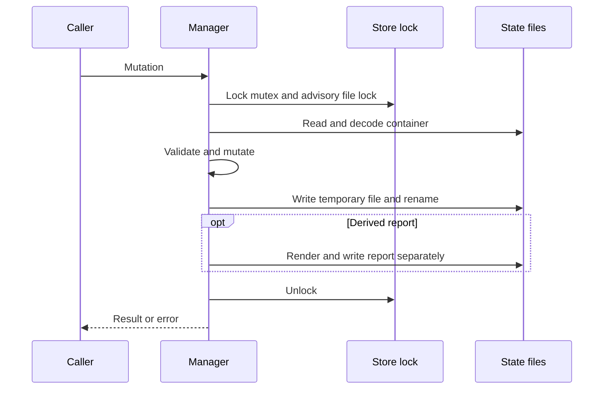

Atomic rename does not make multiple files transactional or guarantee persistence after power loss. Report generation can fail after a primary file is saved, and several report-write errors are ignored. Locks are advisory and different store instances must cooperate through the lock file. Code paths that bypass the lock can race. The `IndexCodebase` path loads and saves the graph without acquiring `Store.Lock`; it can overwrite concurrent graph changes. POSIX lock timeout covers file-lock acquisition after the in-process mutex has been acquired, not time waiting for that mutex. Windows locking is implemented separately in `pkg/state/lock_windows.go`.

## Messages

`SendMessage` locks, gives an empty recipient `all`, derives a time-based ID and default second-resolution thread ID, serializes one JSON object and appends it to `messages.jsonl`. The sender starts in `read_by`. `ReadInbox` locks and loads the entire log, skips malformed JSON lines, scans newest first for recipient/role/thread/unread matches and reverses the selected subset to chronological order. The scanner permits lines up to 4 MiB. Recipient matching does not authenticate the requested identity. `MarkRead` loads all entries, updates matching IDs and atomically rewrites the entire ledger; it does not verify the caller is a recipient. `ListThreads` groups the full log in a map and applies its limit without sorting, so limiting does not reliably select the most recent threads. Rewriting after skipping invalid lines can drop those lines. See [messages.go](../pkg/messages/messages.go).

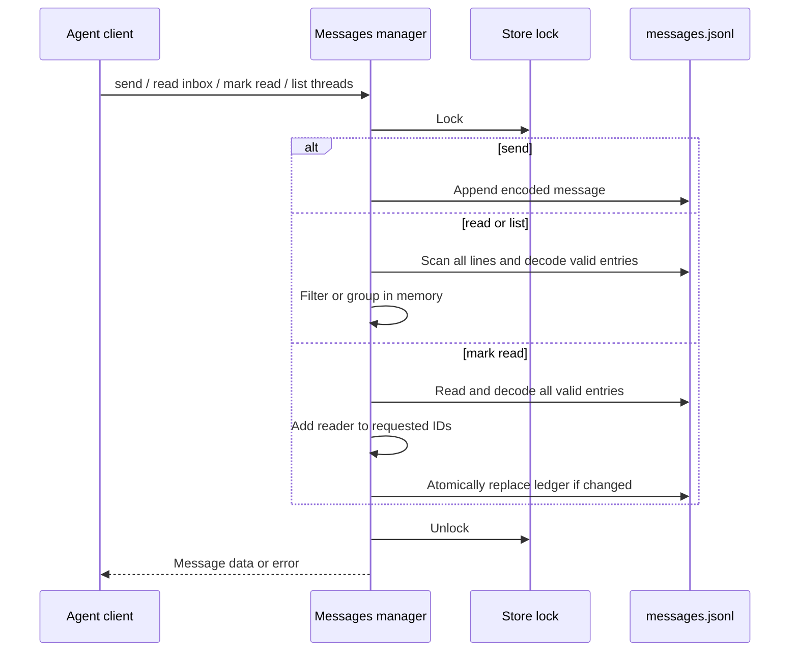

## Tasks and derived lists

Task create loads `tasks.json`, allocates `task-N`, defaults role to `worker` and priority to `normal`, adds inverse `blocks` references for existing prerequisites, runs DFS cycle detection, and saves the container and a derived board. Creation only marks a prerequisite as blocking when it exists and is incomplete; it does not reject an unknown prerequisite. Modification of the dependency list does reject unknown and self dependencies, adjusts inverse references and reruns cycle detection. A move to `in_progress` or `completed` rejects known incomplete prerequisites; it does not reject a missing prerequisite. Completion walks direct downstream blocked tasks and marks them `todo` only if every listed prerequisite exists and is completed. Status strings are not globally constrained by the manager to the defined constants. See [tasks.go](../pkg/tasks/tasks.go).

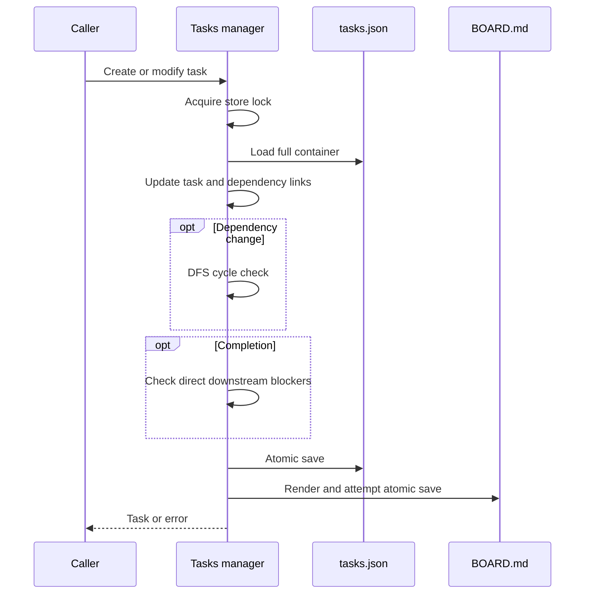

Personal todos are a distinct per-agent scratchpad container (`pkg/tasks/personal_todo.go`); system todos and assignment matrices are derived from other state (`system_todo.go`, `orchestrator.go`). They are not independent schedulers. Reads and writes typically scan or serialize the full relevant container. Board and status displays are snapshots and can become stale if their generating write fails.

## Knowledge graph and indexing

`graph.json` stores node and edge maps. `AddNode` upserts by ID; `AddEdge` creates placeholder concept nodes for absent endpoints and defaults provenance to inferred. Saving writes the graph and attempts a separate report. Query scores case-insensitive substrings: each query token adds 10 for label, 5 for ID, and 2 for the combined text; the same token can earn multiple contributions. Neighborhood traverses edges in both directions using BFS, with depth default 1 and maximum 3. Path search also treats edges bidirectionally, synthesizing an `inverse_` relation for reverse traversal. Thus a returned path does not imply a directed dependency path.

PageRank builds degree/adjacency maps and iterates a power method including dangling-node distribution; defaults are damping 0.85, 100 iterations and tolerance 1e-5. Impact analysis traverses incoming dependency-like relations and includes container members as seeds, caps depth at 5 and computes a heuristic score; it is not proof of actual runtime impact. Clusters are undirected connected components, not statistical communities. Repo-map ranks by PageRank and approximates a token as four characters. Its output budget and truncation count are approximate. See [graph.go](../pkg/graph/graph.go) and [analysis.go](../pkg/graph/analysis.go).

Indexing walks Go source files, skips tests and named hidden/vendor/build directories, parses declarations and imports, and inserts predefined decision and invariant records. It silently skips individual walk and parse errors and does not remove stale graph entries. Package IDs derive from package names rather than full import paths, allowing collisions. The predefined claims are index content, not independent verification; in particular they must not be taken as proof that every access is bounded or every payload has a limit. See [indexer.go](../pkg/graph/indexer.go).

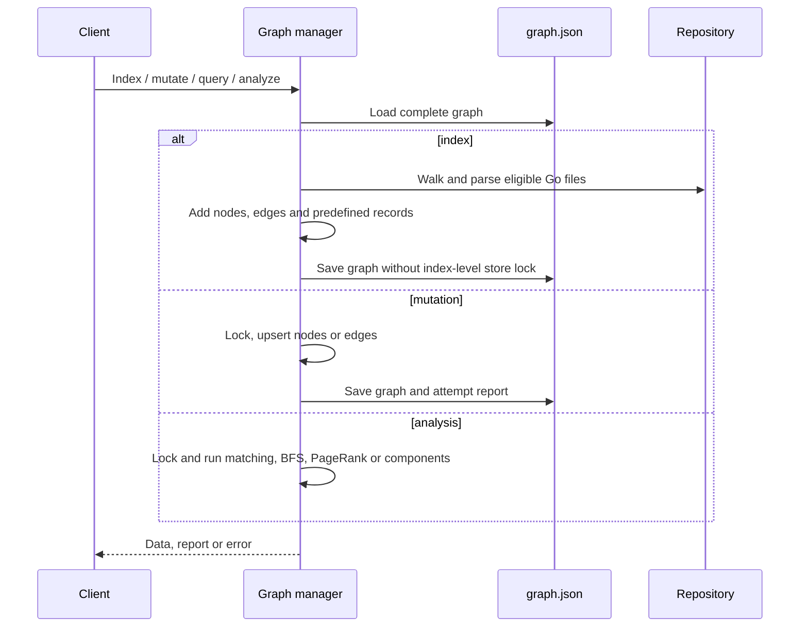

## Debates, reviews and red team

The deliberation manager persists debates, rounds, arguments, ordinary votes, reviews and probes in its container. Starting, posting, voting, reviewing and concluding are separate operations with caller-provided identities. Ranked tally forms the union of listed options and vote choices, gives each ranked position `max(1, option_count - rank_index)` points weighted by `1 + 0.2 * (confidence - 1)`, rounds scores to two decimals, and sorts by score then first-place votes. Remaining ties have no further explicit tie-breaker. Convergence is a heuristic based on round stance distribution and changes; it is not verification of consensus or independent expertise. STRIDE probes are template-generated records, not executed attacks. On conclusion the MCP handler can attempt to insert a decision into the graph, but ignores that insertion error. See [deliberation](../pkg/deliberation/deliberation.go), [ranked voting](../pkg/deliberation/mad.go) and [red team](../pkg/deliberation/redteam.go).

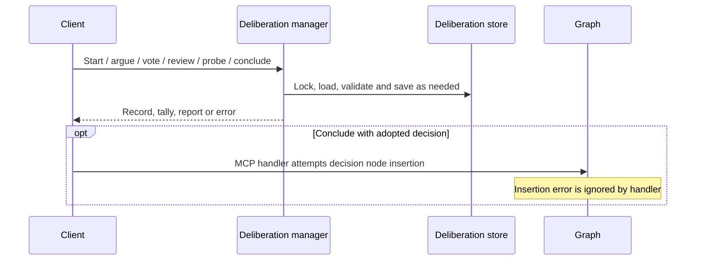

## SOP, guardrails and roles

SOP has `feature_delivery`, `bug_investigation`, and `security_hardening` templates. Starting copies template stages and assigns a timestamp-based ID with seconds resolution. Saving an artifact checks a size limit, sanitizes IDs, validates its destination path, writes Markdown, then records the artifact in the SOP container. The file and container update are not one transaction; the displayed relative artifact path assumes `.local/gossip` even for a custom store. Stage advancement checks the caller-supplied role (or orchestrator override) and the presence of required artifact types for that stage. These gates check records, not the quality of artifacts or the authenticity of roles. See [sop.go](../pkg/sop/sop.go).

Role derivation uses static rules and substring checks on the technology stack; it does not invoke a model despite the MCP description. It replaces baseline invariants and cautions, adds baseline roles and stack-specific roles, and saves guardrails. Validation checks forbidden actions, sensitive paths and caution matches; `require_peer_review` can return `allowed: true`. It is only performed when explicitly called. `filepath.Match` does not implement shell extended glob syntax, so stored patterns resembling extended globs should not be assumed to match as a shell would. Role provider loads embedded defaults, then the first readable override candidate; malformed override errors are ignored. Configuration loading chooses the first valid file as an entire replacement, not a field-by-field merge. See [guardrails.go](../pkg/guardrails/guardrails.go), [roles.go](../pkg/roles/roles.go), and [config.go](../pkg/config/config.go).

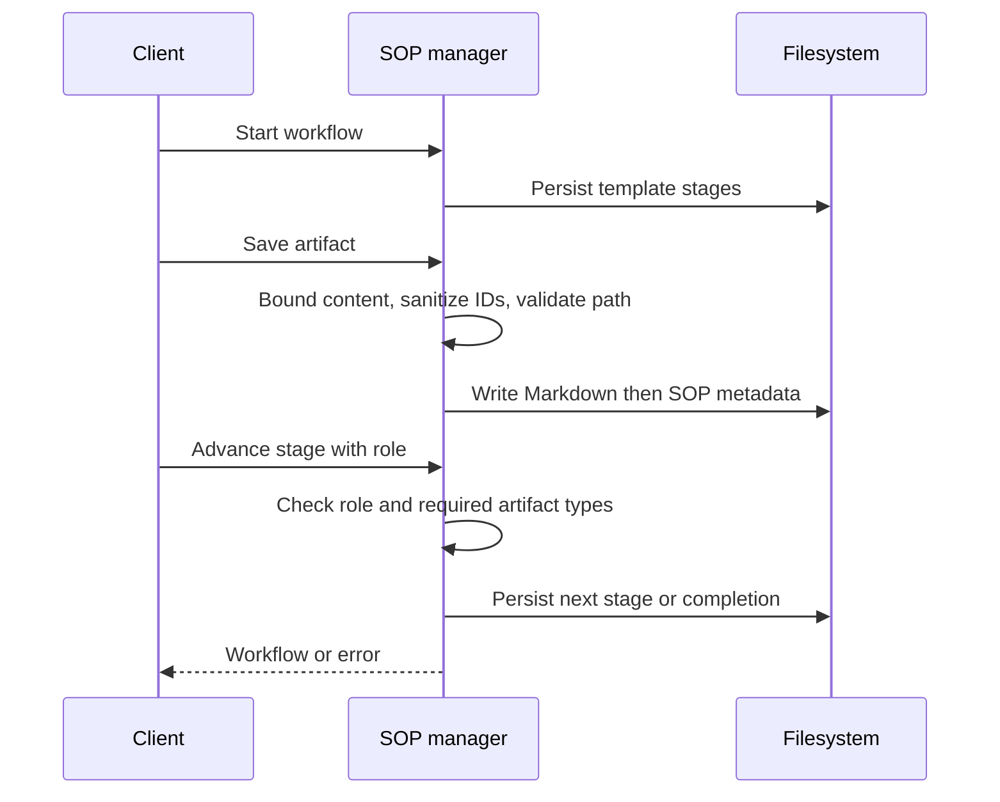

## Events, cron and MoE

Polling gathers events from several local sources and explicit logs rather than subscribing to an OS event stream. It can update a heartbeat, defaults an omitted `since` to one minute ago, checks immediately and then at 300 ms intervals, and caps timeout at 60 seconds. Each scan may acquire multiple locks and read multiple files; failure handling in individual aggregation paths can produce an incomplete snapshot. A caller should use returned timestamps carefully and tolerate duplicates and state changes between reads. See [events.go](../pkg/events/events.go).

Cron's interval parser supports a few shorthands plus Go durations; it is not a general cron-expression parser. `RunCheck` combines inbox, ready tasks, agent heartbeats and tunnel disclosure. Errors for several subchecks are ignored, so a quiet result does not establish all checks succeeded. `Runner.Start` runs an initial check and then a ticker in a goroutine until cancellation; setup of cron configuration alone does not keep a process alive. See [cron.go](../pkg/cron/cron.go).

MoE uses explicit requested roles or substring heuristics, with fallback specialists and a critic; the heuristic result is not an LLM prediction. Panel arguments, synthesis and dispatch tracks are stored records. `Synthesize` records a decision supplied by the caller; dispatch converts supplied work packages into tracks and does not launch agents. `max_parallel` is recorded on the panel; dispatch creates a track for every work package and does not enforce that limit. See [moe.go](../pkg/moe/moe.go).

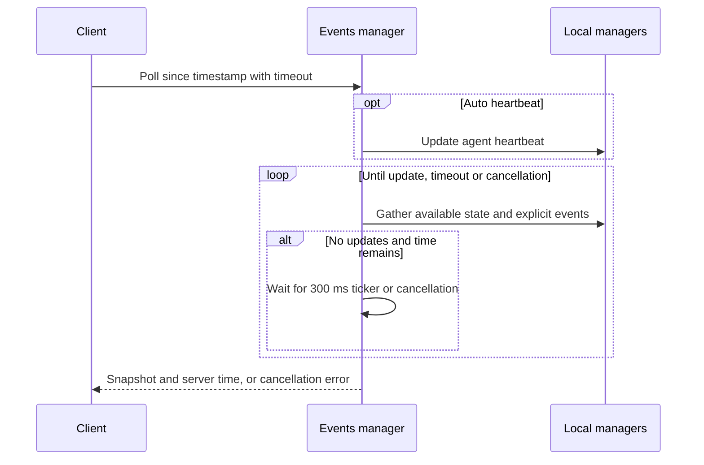

## Tunnel, federation and vault

Tunnel configuration generators return FRP configuration text and tunnel state records metadata, including masked credentials; generating or marking a tunnel active is not proof an FRP process is running or reachable. Disclosure aggregates local state and declared remote agents; it is a report of stored metadata. Federation sends an HTTP POST to `/api/mesh/query`; supported query types are graph, repomap, tasks and status. The receiver executes against its own store. Remote graph queries request a neighborhood by node ID at fixed depth 2. The query result includes local worktree path and disclosure count. See [tunnel.go](../pkg/tunnel/tunnel.go), [disclosure.go](../pkg/tunnel/disclosure.go) and [federation.go](../pkg/tunnel/federation.go).

Vault stages plaintext files and keeps an index. Transfer reads the entire source, hashes, encrypts with AES-GCM, hex-encodes ciphertext into the misleadingly named `payload_b64`, and sends a JSON request including the encryption passphrase. Receiver hex-decodes, decrypts, checks an optional SHA-256 and writes the plaintext. The token supplied with the request is used as decryption material; it does not independently authenticate the sender. The web middleware is a separate optional access control. See [vault.go](../pkg/vault/vault.go) and the security section in the main document.

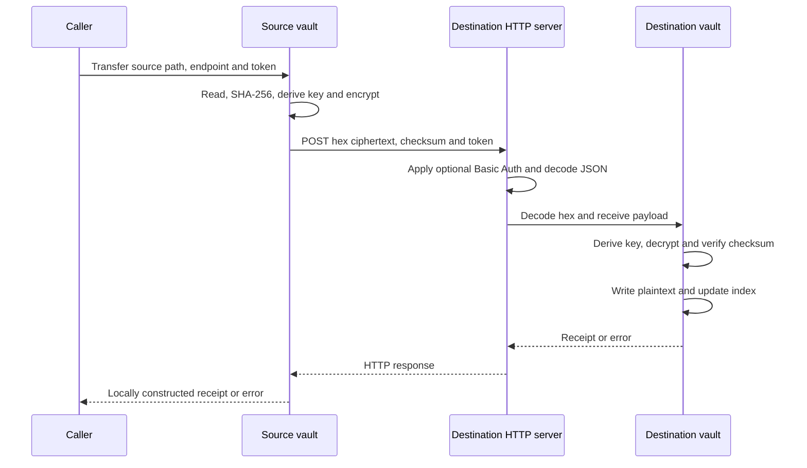

## HTTP route sequences

All routes pass through the middleware shown in the main document. The route diagrams below show statically visible calls inside each handler; a call can be conditional, repeated, or bypassed by an error. Helper methods can themselves perform additional work. Methods accepted by a handler are enforced by its implementation, linked for inspection.
### `/`

Handler: [handleIndex](../pkg/web/server.go#L220). Explicit method checks: none detected.

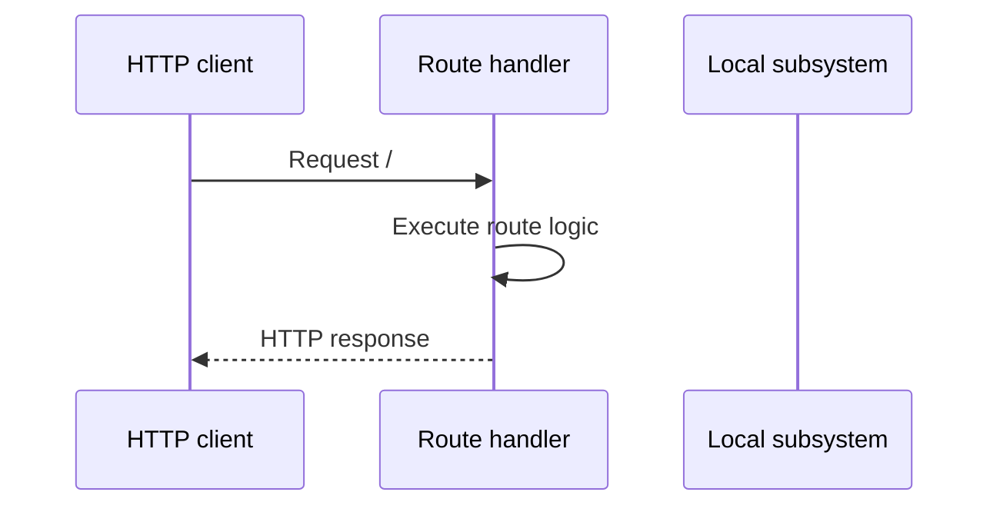

### `/api/projects`

Handler: [handleAPIProjects](../pkg/web/server.go#L229). Explicit method checks: none detected.

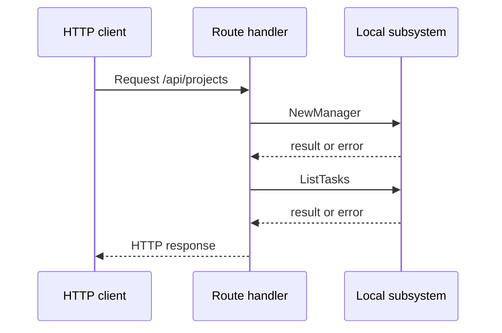

### `/api/projects/select`

Handler: [handleAPIProjectSelect](../pkg/web/server.go#L277). Explicit method checks: Post.

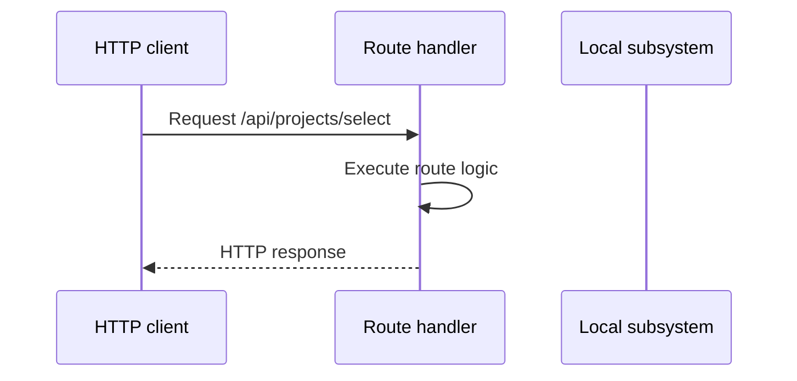

### `/api/projects/add`

Handler: [handleAPIProjectAdd](../pkg/web/server.go#L312). Explicit method checks: Post.

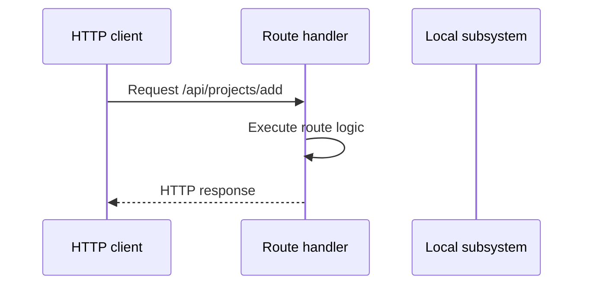

### `/api/projects/init`

Handler: [handleAPIProjectInit](../pkg/web/server.go#L345). Explicit method checks: Post.

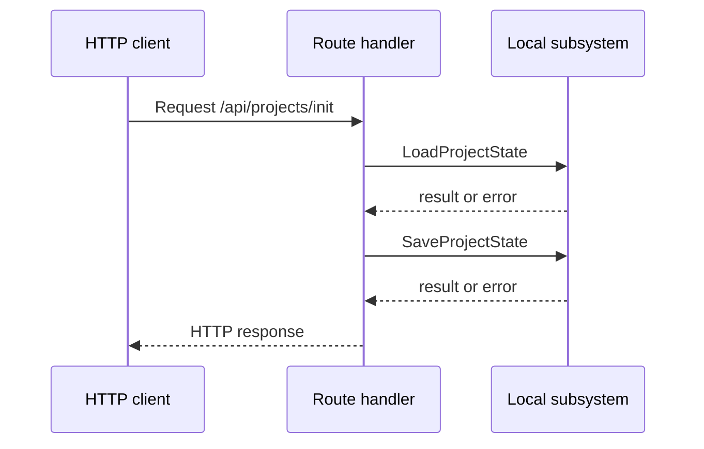

### `/api/status`

Handler: [handleAPIStatus](../pkg/web/server.go#L398). Explicit method checks: none detected.

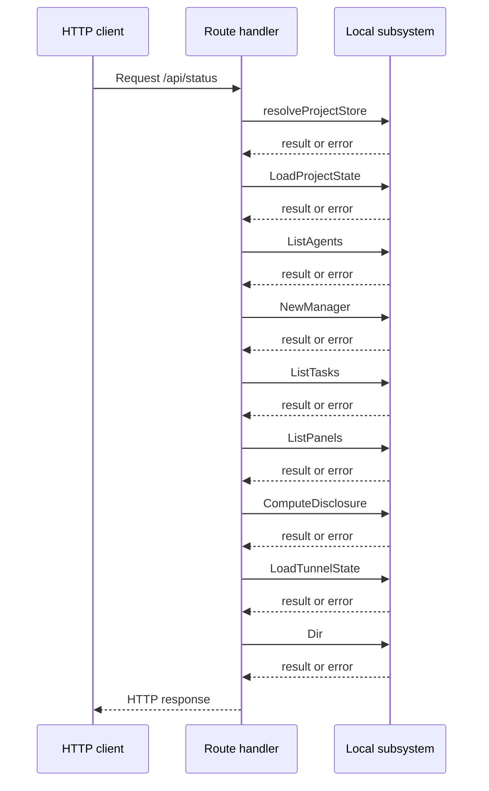

### `/api/tasks`

Handler: [handleAPITasks](../pkg/web/server.go#L436). Explicit method checks: Get, Post.

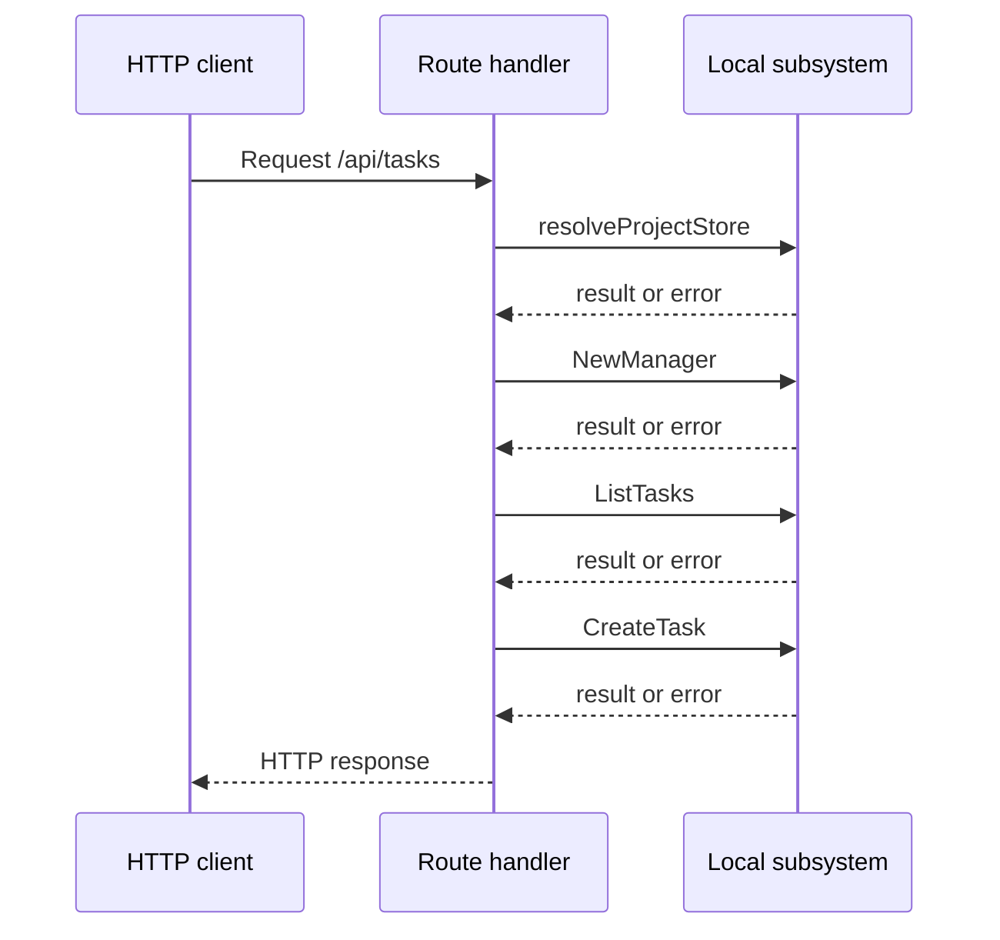

### `/api/tasks/update`

Handler: [handleAPITaskUpdate](../pkg/web/server.go#L478). Explicit method checks: Post.

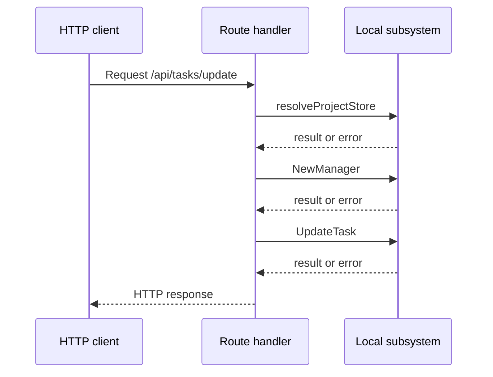

### `/api/tasks/modify`

Handler: [handleAPITaskModify](../pkg/web/server.go#L509). Explicit method checks: Post.

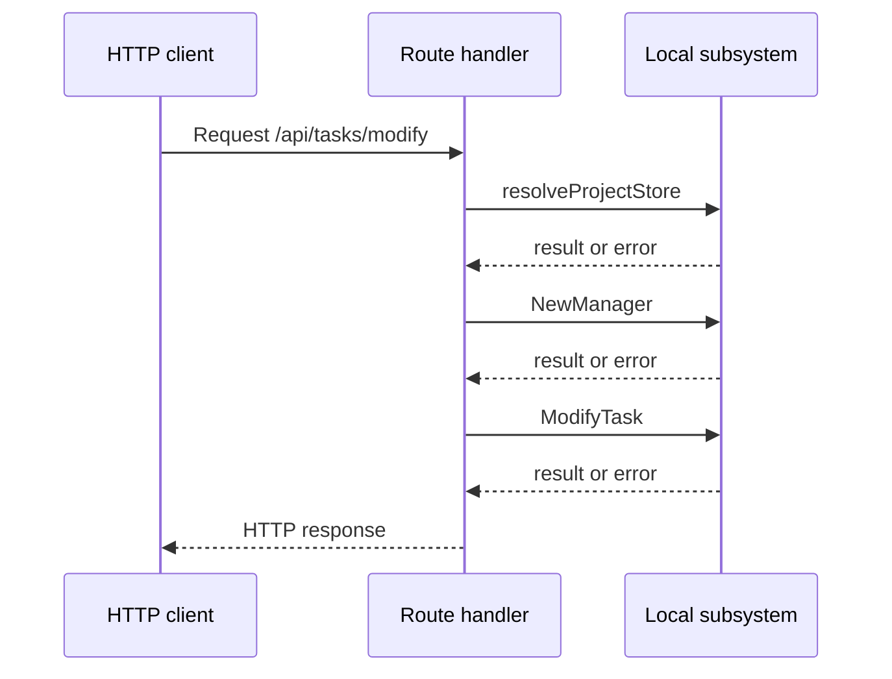

### `/api/artifacts`

Handler: [handleAPIArtifacts](../pkg/web/server.go#L571). Explicit method checks: none detected.

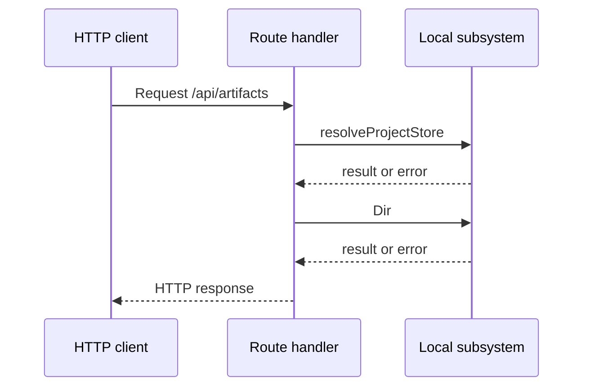

### `/api/artifacts/content`

Handler: [handleAPIArtifactContent](../pkg/web/server.go#L644). Explicit method checks: none detected.

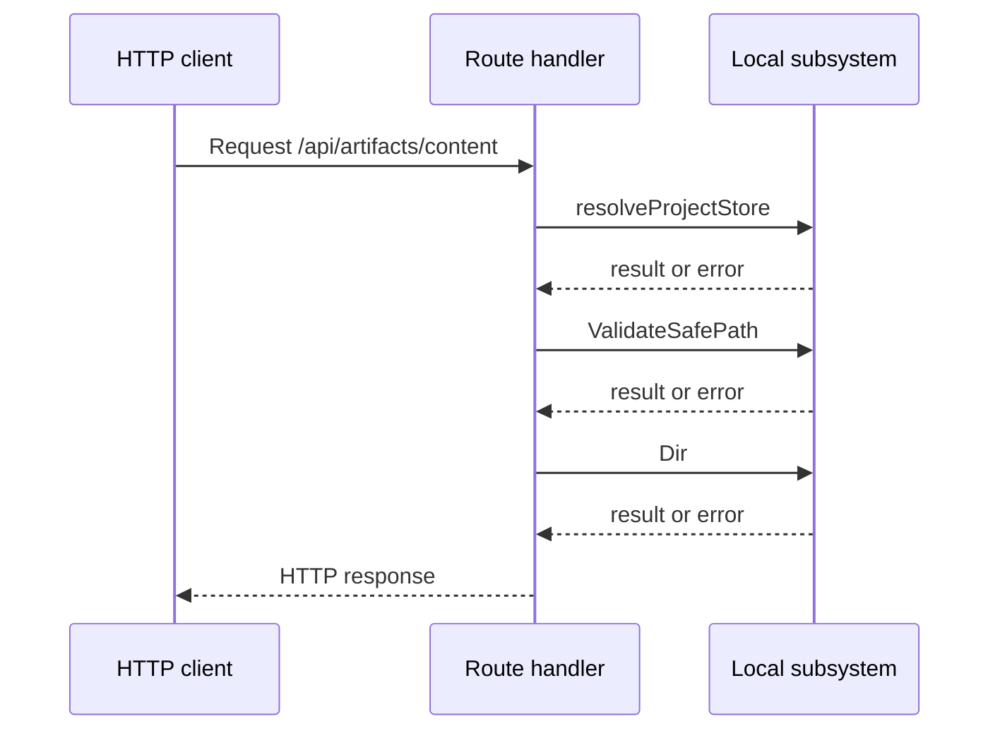

### `/api/artifacts/save`

Handler: [handleAPIArtifactSave](../pkg/web/server.go#L702). Explicit method checks: Post.

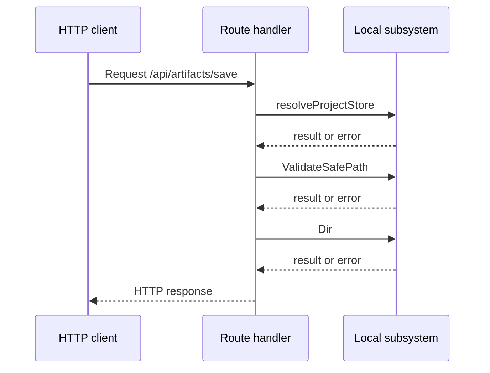

### `/api/artifacts/create`

Handler: [handleAPIArtifactCreate](../pkg/web/server.go#L766). Explicit method checks: Post.

```mermaid
sequenceDiagram
    participant C as HTTP client
    participant H as Route handler
    participant S as Local subsystem
    C->>H: Request /api/artifacts/create
    H->>S: resolveProjectStore
    S-->>H: result or error
    H->>S: Dir
    S-->>H: result or error
    H->>S: ValidateSafePath
    S-->>H: result or error
    H-->>C: HTTP response
```

### `/api/agents`

Handler: [handleAPIAgents](../pkg/web/server.go#L826). Explicit method checks: Get, Post.

```mermaid
sequenceDiagram
    participant C as HTTP client
    participant H as Route handler
    participant S as Local subsystem
    C->>H: Request /api/agents
    H->>S: resolveProjectStore
    S-->>H: result or error
    H->>S: ListAgents
    S-->>H: result or error
    H->>S: RegisterAgent
    S-->>H: result or error
    H-->>C: HTTP response
```

### `/api/messages`

Handler: [handleAPIMessages](../pkg/web/server.go#L862). Explicit method checks: Get, Post.

```mermaid
sequenceDiagram
    participant C as HTTP client
    participant H as Route handler
    participant S as Local subsystem
    C->>H: Request /api/messages
    H->>S: resolveProjectStore
    S-->>H: result or error
    H->>S: NewManager
    S-->>H: result or error
    H-->>C: HTTP response
```

### `/api/broadcast`

Handler: [handleAPIBroadcast](../pkg/web/server.go#L902). Explicit method checks: Post.

```mermaid
sequenceDiagram
    participant C as HTTP client
    participant H as Route handler
    participant S as Local subsystem
    C->>H: Request /api/broadcast
    H->>S: resolveProjectStore
    S-->>H: result or error
    H->>S: NewManager
    S-->>H: result or error
    H-->>C: HTTP response
```

### `/api/moe`

Handler: [handleAPIMoE](../pkg/web/server.go#L932). Explicit method checks: none detected.

```mermaid
sequenceDiagram
    participant C as HTTP client
    participant H as Route handler
    participant S as Local subsystem
    C->>H: Request /api/moe
    H->>S: resolveProjectStore
    S-->>H: result or error
    H->>S: NewManager
    S-->>H: result or error
    H->>S: ListPanels
    S-->>H: result or error
    H-->>C: HTTP response
```

### `/api/moe/convene`

Handler: [handleAPIMoEConvene](../pkg/web/server.go#L947). Explicit method checks: Post.

```mermaid
sequenceDiagram
    participant C as HTTP client
    participant H as Route handler
    participant S as Local subsystem
    C->>H: Request /api/moe/convene
    H->>S: resolveProjectStore
    S-->>H: result or error
    H->>S: NewManager
    S-->>H: result or error
    H->>S: ConvenePanel
    S-->>H: result or error
    H-->>C: HTTP response
```

### `/api/moe/argument`

Handler: [handleAPIMoEArgument](../pkg/web/server.go#L979). Explicit method checks: Post.

```mermaid
sequenceDiagram
    participant C as HTTP client
    participant H as Route handler
    participant S as Local subsystem
    C->>H: Request /api/moe/argument
    H->>S: resolveProjectStore
    S-->>H: result or error
    H->>S: NewManager
    S-->>H: result or error
    H->>S: PostArgument
    S-->>H: result or error
    H-->>C: HTTP response
```

### `/api/moe/synthesize`

Handler: [handleAPIMoESynthesize](../pkg/web/server.go#L1011). Explicit method checks: Post.

```mermaid
sequenceDiagram
    participant C as HTTP client
    participant H as Route handler
    participant S as Local subsystem
    C->>H: Request /api/moe/synthesize
    H->>S: resolveProjectStore
    S-->>H: result or error
    H->>S: NewManager
    S-->>H: result or error
    H->>S: Synthesize
    S-->>H: result or error
    H-->>C: HTTP response
```

### `/api/moe/dispatch`

Handler: [handleAPIMoEDispatch](../pkg/web/server.go#L1043). Explicit method checks: Post.

```mermaid
sequenceDiagram
    participant C as HTTP client
    participant H as Route handler
    participant S as Local subsystem
    C->>H: Request /api/moe/dispatch
    H->>S: resolveProjectStore
    S-->>H: result or error
    H->>S: NewManager
    S-->>H: result or error
    H->>S: DispatchSubagents
    S-->>H: result or error
    H-->>C: HTTP response
```

### `/api/settings`

Handler: [handleAPISettings](../pkg/web/server.go#L1071). Explicit method checks: Get, Post.

```mermaid
sequenceDiagram
    participant C as HTTP client
    participant H as Route handler
    participant S as Local subsystem
    C->>H: Request /api/settings
    H->>S: resolveProjectStore
    S-->>H: result or error
    H->>S: LoadProjectState
    S-->>H: result or error
    H->>S: Load
    S-->>H: result or error
    H->>S: SaveProjectState
    S-->>H: result or error
    H-->>C: HTTP response
```

### `/api/tunnel`

Handler: [handleAPITunnel](../pkg/web/server.go#L1130). GET reads local tunnel disclosure. POST supports deactivation only; other POST actions return 410 and direct callers to the mTLS coordination listener.

```mermaid
sequenceDiagram
    participant C as HTTP client
    participant H as Route handler
    participant S as Local subsystem
    C->>H: Request /api/tunnel
    H->>S: resolveProjectStore
    S-->>H: result or error
    H->>S: LoadTunnelState
    S-->>H: result or error
    H->>S: Dir
    S-->>H: result or error
    H->>S: ComputeDisclosure
    S-->>H: result or error
    H->>S: DetectLocalLANIPs
    S-->>H: result or error
    alt GET
        H->>S: LoadTunnelState, ComputeDisclosure, DetectLocalLANIPs
        S-->>H: disclosure data
    else POST deactivate
        H->>S: Dir, ClearTunnelState
        S-->>H: result or error
    else POST activate/generate
        H-->>C: 410 with secure coordination guidance
    end
    H-->>C: HTTP response
```

### `/api/tunnel/disclosure`

Handler: [handleAPITunnelDisclosure](../pkg/web/server.go#L1270). Explicit method checks: none detected.

```mermaid
sequenceDiagram
    participant C as HTTP client
    participant H as Route handler
    participant S as Local subsystem
    C->>H: Request /api/tunnel/disclosure
    H->>S: resolveProjectStore
    S-->>H: result or error
    H->>S: ComputeDisclosure
    S-->>H: result or error
    H-->>C: HTTP response
```

### `/api/mesh/query`

Handler: [handleAPIMeshQuery](../pkg/web/server.go#L1280). Explicit method checks: Post.

```mermaid
sequenceDiagram
    participant C as HTTP client
    participant H as Route handler
    participant S as Local subsystem
    C->>H: Request /api/mesh/query
    H->>S: resolveProjectStore
    S-->>H: result or error
    H->>S: ExecuteLocalFederatedQuery
    S-->>H: result or error
    H-->>C: HTTP response
```

### `/api/vault/stage`

Handler: [handleAPIVaultStage](../pkg/web/server.go#L1305). Explicit method checks: Post.

```mermaid
sequenceDiagram
    participant C as HTTP client
    participant H as Route handler
    participant S as Local subsystem
    C->>H: Request /api/vault/stage
    H->>S: resolveProjectStore
    S-->>H: result or error
    H->>S: NewManager
    S-->>H: result or error
    H->>S: Dir
    S-->>H: result or error
    H->>S: StageSecretFile
    S-->>H: result or error
    H-->>C: HTTP response
```

### `/api/vault/list`

Handler: [handleAPIVaultList](../pkg/web/server.go#L1343). Explicit method checks: none detected.

```mermaid
sequenceDiagram
    participant C as HTTP client
    participant H as Route handler
    participant S as Local subsystem
    C->>H: Request /api/vault/list
    H->>S: resolveProjectStore
    S-->>H: result or error
    H->>S: NewManager
    S-->>H: result or error
    H->>S: Dir
    S-->>H: result or error
    H->>S: ListStagedFiles
    S-->>H: result or error
    H-->>C: HTTP response
```

### `/api/vault/transfer`

Handler: [handleAPIVaultTransfer](../pkg/web/server.go#L1362). Explicit method checks: Post.

```mermaid
sequenceDiagram
    participant C as HTTP client
    participant H as Route handler
    participant S as Local subsystem
    C->>H: Request /api/vault/transfer
    H->>S: resolveProjectStore
    S-->>H: result or error
    H->>S: NewManager
    S-->>H: result or error
    H->>S: Dir
    S-->>H: result or error
    H->>S: TransferSecretToRemote
    S-->>H: result or error
    H-->>C: HTTP response
```

### `/api/vault/receive`

Handler: [handleAPIVaultReceive](../pkg/web/server.go#L1396). Explicit method checks: Post.

```mermaid
sequenceDiagram
    participant C as HTTP client
    participant H as Route handler
    participant S as Local subsystem
    C->>H: Request /api/vault/receive
    H->>S: resolveProjectStore
    S-->>H: result or error
    H->>S: NewManager
    S-->>H: result or error
    H->>S: Dir
    S-->>H: result or error
    H->>S: ReceiveSecretPayload
    S-->>H: result or error
    H->>S: forEach
    S-->>H: result or error
    H->>S: map
    S-->>H: result or error
    H->>S: trim
    S-->>H: result or error
    H-->>C: HTTP response
```

## CLI dispatch

Every CLI command enters `main`, selects the matching branch, parses that command’s arguments and invokes its handler. Aliases on the same line share a branch. The command-specific source links are authoritative for flags, validation and side effects. Nested subcommands such as `tunnel`, `vault`, `todo`, `moe`, and `cron` are implemented in their linked handler.

### Project-scoped coordination commands

`coord-add` and `coord-access` can administer an existing project over verified mutual TLS. The home checks both the client certificate's project grant and the owner bearer credential. `coord-frp` writes a private FRP TCP config to the local `coord-serve` TLS listener; it does not launch `frpc`. Legacy HTTP dashboard tunnel activation and configuration are disabled.

```mermaid
sequenceDiagram
    participant A as Project administrator
    participant F as FRP TCP proxy
    participant H as coord-serve home
    participant D as Project database
    participant W as Remote user
    A->>D: Grant admin client certificate
    A->>H: coord-add/coord-access over mTLS + owner credential
    H->>D: Check certificate grant and owner role
    H->>D: Enroll principal or update project certificate grant
    A->>F: Start generated private TCP proxy config
    W->>F: HTTPS with client certificate and project credential
    F->>H: Forward TLS stream unchanged
    H->>D: Check per-request project certificate grant and principal role
```

### Legacy `mcp`, `serve`, and no-argument MCP launch (retired)

These entry points return a migration error unconditionally. The former opt-in environment variable no longer enables the JSON-backed MCP adapter because it has no project membership boundary. Use [coord-mcp](../cmd/gossip/coord.go) with a private project credential. The dispatcher and regression coverage are in [main.go](../cmd/gossip/main.go) and [main_test.go](../cmd/gossip/main_test.go).

### `init`

Handler: [runInit](../cmd/gossip/main.go#L212).

```mermaid
sequenceDiagram
    participant U as User
    participant C as CLI main
    participant H as Command handler
    participant S as Subsystems
    U->>C: Invoke init
    C->>H: Dispatch and parse flags
    H->>S: Execute command-specific operations
    S-->>H: Results or error
    H-->>U: Output or exit
```

### `status`

Handler: [runStatus](../cmd/gossip/main.go#L278).

```mermaid
sequenceDiagram
    participant U as User
    participant C as CLI main
    participant H as Command handler
    participant S as Subsystems
    U->>C: Invoke status
    C->>H: Dispatch and parse flags
    H->>S: Execute command-specific operations
    S-->>H: Results or error
    H-->>U: Output or exit
```

### `board`

Handler: [runBoard](../cmd/gossip/main.go#L352).

```mermaid
sequenceDiagram
    participant U as User
    participant C as CLI main
    participant H as Command handler
    participant S as Subsystems
    U->>C: Invoke board
    C->>H: Dispatch and parse flags
    H->>S: Execute command-specific operations
    S-->>H: Results or error
    H-->>U: Output or exit
```

### `report`

Handler: [runReport](../cmd/gossip/main.go#L369).

```mermaid
sequenceDiagram
    participant U as User
    participant C as CLI main
    participant H as Command handler
    participant S as Subsystems
    U->>C: Invoke report
    C->>H: Dispatch and parse flags
    H->>S: Execute command-specific operations
    S-->>H: Results or error
    H-->>U: Output or exit
```

### `tasks`

Handler: [runTasks](../cmd/gossip/main.go#L386).

```mermaid
sequenceDiagram
    participant U as User
    participant C as CLI main
    participant H as Command handler
    participant S as Subsystems
    U->>C: Invoke tasks
    C->>H: Dispatch and parse flags
    H->>S: Execute command-specific operations
    S-->>H: Results or error
    H-->>U: Output or exit
```

### `debates`

Handler: [runDebates](../cmd/gossip/main.go#L412).

```mermaid
sequenceDiagram
    participant U as User
    participant C as CLI main
    participant H as Command handler
    participant S as Subsystems
    U->>C: Invoke debates
    C->>H: Dispatch and parse flags
    H->>S: Execute command-specific operations
    S-->>H: Results or error
    H-->>U: Output or exit
```

### `probes`

Handler: [runProbes](../cmd/gossip/main.go#L438).

```mermaid
sequenceDiagram
    participant U as User
    participant C as CLI main
    participant H as Command handler
    participant S as Subsystems
    U->>C: Invoke probes
    C->>H: Dispatch and parse flags
    H->>S: Execute command-specific operations
    S-->>H: Results or error
    H-->>U: Output or exit
```

### `pagerank`

Handler: [runPageRank](../cmd/gossip/main.go#L495).

```mermaid
sequenceDiagram
    participant U as User
    participant C as CLI main
    participant H as Command handler
    participant S as Subsystems
    U->>C: Invoke pagerank
    C->>H: Dispatch and parse flags
    H->>S: Execute command-specific operations
    S-->>H: Results or error
    H-->>U: Output or exit
```

### `impact`

Handler: [runImpact](../cmd/gossip/main.go#L521).

```mermaid
sequenceDiagram
    participant U as User
    participant C as CLI main
    participant H as Command handler
    participant S as Subsystems
    U->>C: Invoke impact
    C->>H: Dispatch and parse flags
    H->>S: Execute command-specific operations
    S-->>H: Results or error
    H-->>U: Output or exit
```

### `clusters`

Handler: [runClusters](../cmd/gossip/main.go#L572).

```mermaid
sequenceDiagram
    participant U as User
    participant C as CLI main
    participant H as Command handler
    participant S as Subsystems
    U->>C: Invoke clusters
    C->>H: Dispatch and parse flags
    H->>S: Execute command-specific operations
    S-->>H: Results or error
    H-->>U: Output or exit
```

### `repomap`

Handler: [runRepoMap](../cmd/gossip/main.go#L600).

```mermaid
sequenceDiagram
    participant U as User
    participant C as CLI main
    participant H as Command handler
    participant S as Subsystems
    U->>C: Invoke repomap
    C->>H: Dispatch and parse flags
    H->>S: Execute command-specific operations
    S-->>H: Results or error
    H-->>U: Output or exit
```

### `index`, `gsp:index`

Handler: [runIndex](../cmd/gossip/main.go#L904).

```mermaid
sequenceDiagram
    participant U as User
    participant C as CLI main
    participant H as Command handler
    participant S as Subsystems
    U->>C: Invoke index
    C->>H: Dispatch and parse flags
    H->>S: Execute command-specific operations
    S-->>H: Results or error
    H-->>U: Output or exit
```

### `audit`

Handler: [runAudit](../cmd/gossip/main.go#L616).

```mermaid
sequenceDiagram
    participant U as User
    participant C as CLI main
    participant H as Command handler
    participant S as Subsystems
    U->>C: Invoke audit
    C->>H: Dispatch and parse flags
    H->>S: Execute command-specific operations
    S-->>H: Results or error
    H-->>U: Output or exit
```

### `sop`

Handler: [runSOP](../cmd/gossip/main.go#L632).

```mermaid
sequenceDiagram
    participant U as User
    participant C as CLI main
    participant H as Command handler
    participant S as Subsystems
    U->>C: Invoke sop
    C->>H: Dispatch and parse flags
    H->>S: Execute command-specific operations
    S-->>H: Results or error
    H-->>U: Output or exit
```

### `derive`, `gsp:derive`

Handler: [runDerive](../cmd/gossip/main.go#L661).

```mermaid
sequenceDiagram
    participant U as User
    participant C as CLI main
    participant H as Command handler
    participant S as Subsystems
    U->>C: Invoke derive
    C->>H: Dispatch and parse flags
    H->>S: Execute command-specific operations
    S-->>H: Results or error
    H-->>U: Output or exit
```

### `check`, `gsp:check`

Handler: [runCheck](../cmd/gossip/main.go#L723).

```mermaid
sequenceDiagram
    participant U as User
    participant C as CLI main
    participant H as Command handler
    participant S as Subsystems
    U->>C: Invoke check
    C->>H: Dispatch and parse flags
    H->>S: Execute command-specific operations
    S-->>H: Results or error
    H-->>U: Output or exit
```

### `guardrails`, `gsp:guardrails`

Handler: [runGuardrails](../cmd/gossip/main.go#L760).

```mermaid
sequenceDiagram
    participant U as User
    participant C as CLI main
    participant H as Command handler
    participant S as Subsystems
    U->>C: Invoke guardrails
    C->>H: Dispatch and parse flags
    H->>S: Execute command-specific operations
    S-->>H: Results or error
    H-->>U: Output or exit
```

### `agents`, `gsp:agents`

Handler: [runAgents](../cmd/gossip/main.go#L787).

```mermaid
sequenceDiagram
    participant U as User
    participant C as CLI main
    participant H as Command handler
    participant S as Subsystems
    U->>C: Invoke agents
    C->>H: Dispatch and parse flags
    H->>S: Execute command-specific operations
    S-->>H: Results or error
    H-->>U: Output or exit
```

### `poll`, `gsp:poll`

Handler: [runPoll](../cmd/gossip/main.go#L803).

```mermaid
sequenceDiagram
    participant U as User
    participant C as CLI main
    participant H as Command handler
    participant S as Subsystems
    U->>C: Invoke poll
    C->>H: Dispatch and parse flags
    H->>S: Execute command-specific operations
    S-->>H: Results or error
    H-->>U: Output or exit
```

### `watch`, `gsp:watch`

Handler: [runWatch](../cmd/gossip/main.go#L862).

```mermaid
sequenceDiagram
    participant U as User
    participant C as CLI main
    participant H as Command handler
    participant S as Subsystems
    U->>C: Invoke watch
    C->>H: Dispatch and parse flags
    H->>S: Execute command-specific operations
    S-->>H: Results or error
    H-->>U: Output or exit
```

### `todo`, `gsp:my_todos`

Handler: [runPersonalTodo](../cmd/gossip/main.go#L934).

```mermaid
sequenceDiagram
    participant U as User
    participant C as CLI main
    participant H as Command handler
    participant S as Subsystems
    U->>C: Invoke todo
    C->>H: Dispatch and parse flags
    H->>S: Execute command-specific operations
    S-->>H: Results or error
    H-->>U: Output or exit
```

### `system-todos`, `gsp:system_todos`

Handler: [runSystemTodos](../cmd/gossip/main.go#L1011).

```mermaid
sequenceDiagram
    participant U as User
    participant C as CLI main
    participant H as Command handler
    participant S as Subsystems
    U->>C: Invoke system-todos
    C->>H: Dispatch and parse flags
    H->>S: Execute command-specific operations
    S-->>H: Results or error
    H-->>U: Output or exit
```

### `assignments`, `gsp:assignments`

Handler: [runAssignments](../cmd/gossip/main.go#L1028).

```mermaid
sequenceDiagram
    participant U as User
    participant C as CLI main
    participant H as Command handler
    participant S as Subsystems
    U->>C: Invoke assignments
    C->>H: Dispatch and parse flags
    H->>S: Execute command-specific operations
    S-->>H: Results or error
    H-->>U: Output or exit
```

### `resume`, `reidentify`, `gsp:resume`

Handler: [runResume](../cmd/gossip/main.go#L1045).

```mermaid
sequenceDiagram
    participant U as User
    participant C as CLI main
    participant H as Command handler
    participant S as Subsystems
    U->>C: Invoke resume
    C->>H: Dispatch and parse flags
    H->>S: Execute command-specific operations
    S-->>H: Results or error
    H-->>U: Output or exit
```

### `install`

Handler: [runInstall](../cmd/gossip/cli_ext.go#L20).

```mermaid
sequenceDiagram
    participant U as User
    participant C as CLI main
    participant H as Command handler
    participant S as Subsystems
    U->>C: Invoke install
    C->>H: Dispatch and parse flags
    H->>S: Execute command-specific operations
    S-->>H: Results or error
    H-->>U: Output or exit
```

### `tunnel`

Handler: [runTunnel](../cmd/gossip/cli_ext.go#L147).

```mermaid
sequenceDiagram
    participant U as User
    participant C as CLI main
    participant H as Command handler
    participant S as Subsystems
    U->>C: Invoke tunnel
    C->>H: Dispatch and parse flags
    H->>S: Execute command-specific operations
    S-->>H: Results or error
    H-->>U: Output or exit
```

### `cron`

Handler: [runCron](../cmd/gossip/cli_ext.go#L294).

```mermaid
sequenceDiagram
    participant U as User
    participant C as CLI main
    participant H as Command handler
    participant S as Subsystems
    U->>C: Invoke cron
    C->>H: Dispatch and parse flags
    H->>S: Execute command-specific operations
    S-->>H: Results or error
    H-->>U: Output or exit
```

### `vault`

Handler: [runVault](../cmd/gossip/cli_ext.go#L355).

```mermaid
sequenceDiagram
    participant U as User
    participant C as CLI main
    participant H as Command handler
    participant S as Subsystems
    U->>C: Invoke vault
    C->>H: Dispatch and parse flags
    H->>S: Execute command-specific operations
    S-->>H: Results or error
    H-->>U: Output or exit
```

### `remote`

Handler: [runRemote](../cmd/gossip/cli_ext.go#L424).

```mermaid
sequenceDiagram
    participant U as User
    participant C as CLI main
    participant H as Command handler
    participant S as Subsystems
    U->>C: Invoke remote
    C->>H: Dispatch and parse flags
    H->>S: Execute command-specific operations
    S-->>H: Results or error
    H-->>U: Output or exit
```

### `ui`, `web`

Handler: [runWebUI](../cmd/gossip/main.go#L1185).

The legacy UI binds to loopback. Supplying `--frp-server` exits with guidance to use `coord-serve` behind an FRP TCP proxy; legacy HTTP tunneling is disabled.

```mermaid
sequenceDiagram
    participant U as User
    participant C as CLI main
    participant H as Command handler
    participant S as Subsystems
    U->>C: Invoke ui
    C->>H: Dispatch and parse flags
    H->>S: Execute command-specific operations
    S-->>H: Results or error
    H-->>U: Output or exit
```

### `moe`, `gsp:moe`

Handler: [runMoE](../cmd/gossip/main.go#L1245).

```mermaid
sequenceDiagram
    participant U as User
    participant C as CLI main
    participant H as Command handler
    participant S as Subsystems
    U->>C: Invoke moe
    C->>H: Dispatch and parse flags
    H->>S: Execute command-specific operations
    S-->>H: Results or error
    H-->>U: Output or exit
```

### `export-mcp`, `mcp-export`

Retired. These commands return the legacy MCP migration error because the package's schemas do not enforce project membership. The legacy exporter has been removed. See [the supported project-scoped adapter](../cmd/gossip/coord.go).

```mermaid
sequenceDiagram
    participant U as User
    participant C as CLI main
    participant H as Command handler
    participant S as Subsystems
    U->>C: Invoke export-mcp
    C->>H: Dispatch and parse flags
    H->>S: Execute command-specific operations
    S-->>H: Results or error
    H-->>U: Output or exit
```

### `roles`

Handler: `main`.

```mermaid
sequenceDiagram
    participant U as User
    participant C as CLI main
    participant H as Command handler
    participant S as Subsystems
    U->>C: Invoke roles
    C->>H: Dispatch and parse flags
    H->>S: Execute command-specific operations
    S-->>H: Results or error
    H-->>U: Output or exit
```

### `send`

Handler: [runSend](../cmd/gossip/main.go#L464).

```mermaid
sequenceDiagram
    participant U as User
    participant C as CLI main
    participant H as Command handler
    participant S as Subsystems
    U->>C: Invoke send
    C->>H: Dispatch and parse flags
    H->>S: Execute command-specific operations
    S-->>H: Results or error
    H-->>U: Output or exit
```

### `version`, `-v`, `--version`

Handler: `main`.

```mermaid
sequenceDiagram
    participant U as User
    participant C as CLI main
    participant H as Command handler
    participant S as Subsystems
    U->>C: Invoke version
    C->>H: Dispatch and parse flags
    H->>S: Execute command-specific operations
    S-->>H: Results or error
    H-->>U: Output or exit
```

### `help`, `-h`, `--help`

Handler: `main`.

```mermaid
sequenceDiagram
    participant U as User
    participant C as CLI main
    participant H as Command handler
    participant S as Subsystems
    U->>C: Invoke help
    C->>H: Dispatch and parse flags
    H->>S: Execute command-specific operations
    S-->>H: Results or error
    H-->>U: Output or exit
```

## CLI subcommand branches

The main CLI diagrams above show dispatch. These sequences expand the commands with distinct subcommands. The links in the dispatch section contain the complete flag and error handling.

### `todo add`

```mermaid
sequenceDiagram
    participant U as User
    participant C as CLI handler
    participant M as Manager or subsystem
    U->>C: todo add
    C->>C: Parse arguments and validate inputs
    C->>M: AddPersonalTodo
    M-->>C: Result or error
    C-->>U: Output or exit
```

### `todo list (default)`

```mermaid
sequenceDiagram
    participant U as User
    participant C as CLI handler
    participant M as Manager or subsystem
    U->>C: todo list (default)
    C->>C: Parse arguments and validate inputs
    C->>M: ListPersonalTodos
    M-->>C: Result or error
    C-->>U: Output or exit
```

### `moe list (default)`

```mermaid
sequenceDiagram
    participant U as User
    participant C as CLI handler
    participant M as Manager or subsystem
    U->>C: moe list (default)
    C->>C: Parse arguments and validate inputs
    C->>M: ListPanels and render
    M-->>C: Result or error
    C-->>U: Output or exit
```

### `moe convene`

```mermaid
sequenceDiagram
    participant U as User
    participant C as CLI handler
    participant M as Manager or subsystem
    U->>C: moe convene
    C->>C: Parse arguments and validate inputs
    C->>M: ConvenePanel and render
    M-->>C: Result or error
    C-->>U: Output or exit
```

### `moe view`

```mermaid
sequenceDiagram
    participant U as User
    participant C as CLI handler
    participant M as Manager or subsystem
    U->>C: moe view
    C->>C: Parse arguments and validate inputs
    C->>M: GetPanel and render
    M-->>C: Result or error
    C-->>U: Output or exit
```

### `tunnel init / start / activate`

Rejected by the CLI because this legacy tunnel exposes the HTTP dashboard without the project-scoped mTLS boundary. Use `coord-serve` with an FRP TCP proxy.

```mermaid
sequenceDiagram
    participant U as User
    participant C as CLI handler
    participant M as Manager or subsystem
    U->>C: tunnel init / start / activate
    C->>C: Reject legacy HTTP exposure
    C-->>U: Secure coordination guidance and exit
```

### `tunnel config`

Rejected because generated legacy HTTP tunnel configurations do not provide project-scoped mTLS. Use `coord-serve` with an FRP TCP proxy.

```mermaid
sequenceDiagram
    participant U as User
    participant C as CLI handler
    participant M as Manager or subsystem
    U->>C: tunnel config
    C->>C: Reject legacy HTTP exposure
    C-->>U: Secure coordination guidance and exit
```

### `tunnel status`

```mermaid
sequenceDiagram
    participant U as User
    participant C as CLI handler
    participant M as Manager or subsystem
    U->>C: tunnel status
    C->>C: Parse arguments and validate inputs
    C->>M: Compute disclosure
    M-->>C: Result or error
    C-->>U: Output or exit
```

### `tunnel stop / deactivate`

```mermaid
sequenceDiagram
    participant U as User
    participant C as CLI handler
    participant M as Manager or subsystem
    U->>C: tunnel stop / deactivate
    C->>C: Parse arguments and validate inputs
    C->>M: Clear tunnel state
    M-->>C: Result or error
    C-->>U: Output or exit
```

### `vault stage`

```mermaid
sequenceDiagram
    participant U as User
    participant C as CLI handler
    participant M as Manager or subsystem
    U->>C: vault stage
    C->>C: Parse arguments and validate inputs
    C->>M: StageSecretFile
    M-->>C: Result or error
    C-->>U: Output or exit
```

### `vault list`

```mermaid
sequenceDiagram
    participant U as User
    participant C as CLI handler
    participant M as Manager or subsystem
    U->>C: vault list
    C->>C: Parse arguments and validate inputs
    C->>M: ListStagedFiles
    M-->>C: Result or error
    C-->>U: Output or exit
```

### `vault send / transfer`

```mermaid
sequenceDiagram
    participant U as User
    participant C as CLI handler
    participant M as Manager or subsystem
    U->>C: vault send / transfer
    C->>C: Parse arguments and validate inputs
    C->>M: TransferSecretToRemote
    M-->>C: Result or error
    C-->>U: Output or exit
```

### `cron check / pulse`

```mermaid
sequenceDiagram
    participant U as User
    participant C as CLI handler
    participant M as Manager or subsystem
    U->>C: cron check / pulse
    C->>C: Parse arguments and validate inputs
    C->>M: RunCheck and append cron log
    M-->>C: Result or error
    C-->>U: Output or exit
```

### `cron start / daemon`

```mermaid
sequenceDiagram
    participant U as User
    participant C as CLI handler
    participant M as Manager or subsystem
    U->>C: cron start / daemon
    C->>C: Parse arguments and validate inputs
    C->>M: Parse interval, start Runner, wait indefinitely
    M-->>C: Result or error
    C-->>U: Output or exit
```

## MCP prompt operations

Prompts return instruction text to the client. They do not themselves run the suggested tools. Each registered prompt follows this sequence, with prompt-specific arguments and text in its linked handler.

### `gsp:derive_roles`

[Prompt registration and handler](../pkg/mcp/server.go#L2405).

```mermaid
sequenceDiagram
    participant C as MCP client
    participant P as Prompt handler
    C->>P: Get gsp:derive_roles with arguments
    P->>P: Format instruction text
    P-->>C: Prompt messages
```

### `gsp:blast_radius`

[Prompt registration and handler](../pkg/mcp/server.go#L2419).

```mermaid
sequenceDiagram
    participant C as MCP client
    participant P as Prompt handler
    C->>P: Get gsp:blast_radius with arguments
    P->>P: Format instruction text
    P-->>C: Prompt messages
```

### `gsp:sop_advance`

[Prompt registration and handler](../pkg/mcp/server.go#L2431).

```mermaid
sequenceDiagram
    participant C as MCP client
    participant P as Prompt handler
    C->>P: Get gsp:sop_advance with arguments
    P->>P: Format instruction text
    P-->>C: Prompt messages
```

### `gsp:debate`

[Prompt registration and handler](../pkg/mcp/server.go#L2443).

```mermaid
sequenceDiagram
    participant C as MCP client
    participant P as Prompt handler
    C->>P: Get gsp:debate with arguments
    P->>P: Format instruction text
    P-->>C: Prompt messages
```

### `gsp:stride_audit`

[Prompt registration and handler](../pkg/mcp/server.go#L2455).

```mermaid
sequenceDiagram
    participant C as MCP client
    participant P as Prompt handler
    C->>P: Get gsp:stride_audit with arguments
    P->>P: Format instruction text
    P-->>C: Prompt messages
```

### `gsp:review`

[Prompt registration and handler](../pkg/mcp/server.go#L2467).

```mermaid
sequenceDiagram
    participant C as MCP client
    participant P as Prompt handler
    C->>P: Get gsp:review with arguments
    P->>P: Format instruction text
    P-->>C: Prompt messages
```

### `gsp:guardrail_check`

[Prompt registration and handler](../pkg/mcp/server.go#L2479).

```mermaid
sequenceDiagram
    participant C as MCP client
    participant P as Prompt handler
    C->>P: Get gsp:guardrail_check with arguments
    P->>P: Format instruction text
    P-->>C: Prompt messages
```

### `gsp:repomap`

[Prompt registration and handler](../pkg/mcp/server.go#L2493).

```mermaid
sequenceDiagram
    participant C as MCP client
    participant P as Prompt handler
    C->>P: Get gsp:repomap with arguments
    P->>P: Format instruction text
    P-->>C: Prompt messages
```

### `gsp:poll`

[Prompt registration and handler](../pkg/mcp/server.go#L2508).

```mermaid
sequenceDiagram
    participant C as MCP client
    participant P as Prompt handler
    C->>P: Get gsp:poll with arguments
    P->>P: Format instruction text
    P-->>C: Prompt messages
```

### `gsp:assignments`

[Prompt registration and handler](../pkg/mcp/server.go#L2527).

```mermaid
sequenceDiagram
    participant C as MCP client
    participant P as Prompt handler
    C->>P: Get gsp:assignments with arguments
    P->>P: Format instruction text
    P-->>C: Prompt messages
```

### `gsp:my_todos`

[Prompt registration and handler](../pkg/mcp/server.go#L2537).

```mermaid
sequenceDiagram
    participant C as MCP client
    participant P as Prompt handler
    C->>P: Get gsp:my_todos with arguments
    P->>P: Format instruction text
    P-->>C: Prompt messages
```

### `gsp:system_todos`

[Prompt registration and handler](../pkg/mcp/server.go#L2549).

```mermaid
sequenceDiagram
    participant C as MCP client
    participant P as Prompt handler
    C->>P: Get gsp:system_todos with arguments
    P->>P: Format instruction text
    P-->>C: Prompt messages
```

### `gsp:resume`

[Prompt registration and handler](../pkg/mcp/server.go#L2559).

```mermaid
sequenceDiagram
    participant C as MCP client
    participant P as Prompt handler
    C->>P: Get gsp:resume with arguments
    P->>P: Format instruction text
    P-->>C: Prompt messages
```

### `gsp:moe`

[Prompt registration and handler](../pkg/mcp/server.go#L2573).

```mermaid
sequenceDiagram
    participant C as MCP client
    participant P as Prompt handler
    C->>P: Get gsp:moe with arguments
    P->>P: Format instruction text
    P-->>C: Prompt messages
```

### `gsp:parallel`

[Prompt registration and handler](../pkg/mcp/server.go#L2589).

```mermaid
sequenceDiagram
    participant C as MCP client
    participant P as Prompt handler
    C->>P: Get gsp:parallel with arguments
    P->>P: Format instruction text
    P-->>C: Prompt messages
```

## Production Go function inventory

This index enumerates top-level function and method declarations in every production Go source file under `cmd/` and `pkg/`, including platform-specific alternatives. Links go to source. It provides file and declaration coverage only: a listing does not prove that every statement or failure path has been analyzed or tested. Anonymous functions and browser JavaScript are contained in their enclosing source files and are not separately enumerated.

### `cmd/gossip/cli_ext.go`

[runInstall](../cmd/gossip/cli_ext.go#L20), [runTunnel](../cmd/gossip/cli_ext.go#L147), [printTunnelHelp](../cmd/gossip/cli_ext.go#L284), [runCron](../cmd/gossip/cli_ext.go#L294), [runVault](../cmd/gossip/cli_ext.go#L355), [printVaultHelp](../cmd/gossip/cli_ext.go#L415), [runRemote](../cmd/gossip/cli_ext.go#L424)

### `cmd/gossip/main.go`

[main](../cmd/gossip/main.go), [legacyMCPRetiredError](../cmd/gossip/main.go), [parseDirFlag](../cmd/gossip/main.go), [runInit](../cmd/gossip/main.go), [runStatus](../cmd/gossip/main.go), [runBoard](../cmd/gossip/main.go), [runReport](../cmd/gossip/main.go), [runTasks](../cmd/gossip/main.go), [runDebates](../cmd/gossip/main.go), [runProbes](../cmd/gossip/main.go), [runSend](../cmd/gossip/main.go), [runPageRank](../cmd/gossip/main.go), [runImpact](../cmd/gossip/main.go), [runClusters](../cmd/gossip/main.go), [runRepoMap](../cmd/gossip/main.go), [runAudit](../cmd/gossip/main.go), [runSOP](../cmd/gossip/main.go), [runDerive](../cmd/gossip/main.go), [runCheck](../cmd/gossip/main.go), [runGuardrails](../cmd/gossip/main.go), [runAgents](../cmd/gossip/main.go), [runPoll](../cmd/gossip/main.go), [runWatch](../cmd/gossip/main.go), [runIndex](../cmd/gossip/main.go), [runPersonalTodo](../cmd/gossip/main.go), [runSystemTodos](../cmd/gossip/main.go), [runAssignments](../cmd/gossip/main.go), [runResume](../cmd/gossip/main.go), [runWebUI](../cmd/gossip/main.go), [runMoE](../cmd/gossip/main.go), [printHelp](../cmd/gossip/main.go)

### `pkg/config/config.go`

[DefaultConfig](../pkg/config/config.go#L65), [LoadConfig](../pkg/config/config.go#L78)

### `pkg/cron/cron.go`

[ParseInterval](../pkg/cron/cron.go#L36), [RunCheck](../pkg/cron/cron.go#L61), [NewRunner](../pkg/cron/cron.go#L158), [Start](../pkg/cron/cron.go#L170), [Stop](../pkg/cron/cron.go#L207), [LastResult](../pkg/cron/cron.go#L214), [RecordCronLog](../pkg/cron/cron.go#L221)

### `pkg/deliberation/deliberation.go`

[NewManager](../pkg/deliberation/deliberation.go#L152), [filePath](../pkg/deliberation/deliberation.go#L156), [Load](../pkg/deliberation/deliberation.go#L161), [Save](../pkg/deliberation/deliberation.go#L192), [StartDebate](../pkg/deliberation/deliberation.go#L201), [PostArgument](../pkg/deliberation/deliberation.go#L244), [AdvanceRound](../pkg/deliberation/deliberation.go#L294), [CastVote](../pkg/deliberation/deliberation.go#L323), [ConcludeDebate](../pkg/deliberation/deliberation.go#L372), [RequestReview](../pkg/deliberation/deliberation.go#L430), [SubmitReview](../pkg/deliberation/deliberation.go#L466), [LogRedTeamProbe](../pkg/deliberation/deliberation.go#L498), [ListDebates](../pkg/deliberation/deliberation.go#L539), [ListReviews](../pkg/deliberation/deliberation.go#L562), [ListProbes](../pkg/deliberation/deliberation.go#L585)

### `pkg/deliberation/mad.go`

[CastRankedVote](../pkg/deliberation/mad.go#L60), [TallyRankedVotes](../pkg/deliberation/mad.go#L108), [CheckConvergence](../pkg/deliberation/mad.go#L218)

### `pkg/deliberation/redteam.go`

[GenerateSTRIDEProbes](../pkg/deliberation/redteam.go#L20), [LogBatchProbes](../pkg/deliberation/redteam.go#L82), [GenerateAuditReport](../pkg/deliberation/redteam.go#L110), [buildAuditReport](../pkg/deliberation/redteam.go#L130)

### `pkg/events/events.go`

[NewManager](../pkg/events/events.go#L85), [eventsFilePath](../pkg/events/events.go#L101), [LogEvent](../pkg/events/events.go#L106), [Poll](../pkg/events/events.go#L148), [gatherEvents](../pkg/events/events.go#L213), [loadExplicitEventsSince](../pkg/events/events.go#L449)

### `pkg/graph/analysis.go`

[ComputePageRank](../pkg/graph/analysis.go#L74), [calculatePageRank](../pkg/graph/analysis.go#L89), [AffectedNodes](../pkg/graph/analysis.go#L188), [DetectClusters](../pkg/graph/analysis.go#L375), [GenerateRepoMap](../pkg/graph/analysis.go#L473)

### `pkg/graph/graph.go`

[NewManager](../pkg/graph/graph.go#L85), [graphFilePath](../pkg/graph/graph.go#L89), [reportFilePath](../pkg/graph/graph.go#L93), [LoadGraph](../pkg/graph/graph.go#L98), [SaveGraph](../pkg/graph/graph.go#L126), [AddNode](../pkg/graph/graph.go#L145), [AddEdge](../pkg/graph/graph.go#L173), [GetNode](../pkg/graph/graph.go#L226), [Query](../pkg/graph/graph.go#L246), [GetNeighborhood](../pkg/graph/graph.go#L315), [FindPath](../pkg/graph/graph.go#L389), [GenerateReport](../pkg/graph/graph.go#L464), [generateReport](../pkg/graph/graph.go#L480)

### `pkg/graph/indexer.go`

[IndexCodebase](../pkg/graph/indexer.go#L27), [parseGoSourceFile](../pkg/graph/indexer.go#L206), [indexArchitecturalDecisionsAndInvariants](../pkg/graph/indexer.go#L290)

### `pkg/guardrails/guardrails.go`

[NewManager](../pkg/guardrails/guardrails.go#L78), [dbFilePath](../pkg/guardrails/guardrails.go#L82), [Load](../pkg/guardrails/guardrails.go#L87), [Save](../pkg/guardrails/guardrails.go#L116), [DeriveProjectRoles](../pkg/guardrails/guardrails.go#L146), [SetCautionRule](../pkg/guardrails/guardrails.go#L278), [ValidateProposedAction](../pkg/guardrails/guardrails.go#L310), [RenderAgentsMD](../pkg/guardrails/guardrails.go#L387), [RenderRulesMD](../pkg/guardrails/guardrails.go#L430), [GetGuardrails](../pkg/guardrails/guardrails.go#L448), [ExportAgentsMD](../pkg/guardrails/guardrails.go#L453)

### `pkg/mcp/server.go`

[NewServer](../pkg/mcp/server.go#L47), [ServeStdio](../pkg/mcp/server.go#L92), [MCPServer](../pkg/mcp/server.go#L97), [registerTools](../pkg/mcp/server.go#L101), [getArgsMap](../pkg/mcp/server.go#L115), [getString](../pkg/mcp/server.go#L133), [getBool](../pkg/mcp/server.go#L142), [getInt](../pkg/mcp/server.go#L151), [getFloat](../pkg/mcp/server.go#L165), [getStringSlice](../pkg/mcp/server.go#L181), [toJSONText](../pkg/mcp/server.go#L199), [parseTimeFlexible](../pkg/mcp/server.go#L207), [registerRoleTools](../pkg/mcp/server.go#L235), [registerMessageTools](../pkg/mcp/server.go#L1043), [registerTaskTools](../pkg/mcp/server.go#L1173), [registerGraphTools](../pkg/mcp/server.go#L1485), [registerDeliberationTools](../pkg/mcp/server.go#L1773), [registerSOPTools](../pkg/mcp/server.go#L2141), [registerGuardrailTools](../pkg/mcp/server.go#L2262), [registerPrompts](../pkg/mcp/server.go#L2403), [registerEventTools](../pkg/mcp/server.go#L2603), [registerMoETools](../pkg/mcp/server.go#L2734)

### `pkg/messages/messages.go`

[NewManager](../pkg/messages/messages.go#L43), [messagesFilePath](../pkg/messages/messages.go#L47), [SendMessage](../pkg/messages/messages.go#L52), [LoadAllMessages](../pkg/messages/messages.go#L99), [ReadInbox](../pkg/messages/messages.go#L131), [MarkRead](../pkg/messages/messages.go#L207), [ListThreads](../pkg/messages/messages.go#L260)

### `pkg/moe/moe.go`

[NewManager](../pkg/moe/moe.go#L95), [filePath](../pkg/moe/moe.go#L105), [Load](../pkg/moe/moe.go#L110), [Save](../pkg/moe/moe.go#L126), [GatingFunction](../pkg/moe/moe.go#L135), [ConvenePanel](../pkg/moe/moe.go#L223), [PostArgument](../pkg/moe/moe.go#L266), [Synthesize](../pkg/moe/moe.go#L306), [DispatchSubagents](../pkg/moe/moe.go#L346), [GetPanel](../pkg/moe/moe.go#L397), [ListPanels](../pkg/moe/moe.go#L417), [RenderMarkdown](../pkg/moe/moe.go#L439)

### `pkg/roles/roles.go`

[NewService](../pkg/roles/roles.go#L61), [GetDefaultService](../pkg/roles/roles.go#L93), [loadFromBytes](../pkg/roles/roles.go#L104), [normalizeRoleID](../pkg/roles/roles.go#L130), [GetRole](../pkg/roles/roles.go#L137), [ListRoles](../pkg/roles/roles.go#L145), [RegisterRole](../pkg/roles/roles.go#L156), [SaveToFile](../pkg/roles/roles.go#L168), [FormatRoleSummary](../pkg/roles/roles.go#L195), [GetRole](../pkg/roles/roles.go#L216), [ListRoles](../pkg/roles/roles.go#L220), [RegisterRole](../pkg/roles/roles.go#L224), [FormatRoleSummary](../pkg/roles/roles.go#L228), [GetDefaultRolesJSON](../pkg/roles/roles.go#L233)

### `pkg/security/security.go`

[SanitizeID](../pkg/security/security.go#L27), [ValidateSafePath](../pkg/security/security.go#L56), [ValidatePayloadSize](../pkg/security/security.go#L118), [AuthorizeAction](../pkg/security/security.go#L129)

### `pkg/sop/sop.go`

[NewManager](../pkg/sop/sop.go#L94), [sopFilePath](../pkg/sop/sop.go#L98), [artifactsDir](../pkg/sop/sop.go#L102), [pipelineFilePath](../pkg/sop/sop.go#L106), [Load](../pkg/sop/sop.go#L111), [Save](../pkg/sop/sop.go#L135), [GetWorkflowTemplates](../pkg/sop/sop.go#L154), [StartWorkflow](../pkg/sop/sop.go#L294), [SaveArtifact](../pkg/sop/sop.go#L342), [AdvanceStage](../pkg/sop/sop.go#L432), [GetWorkflow](../pkg/sop/sop.go#L511), [ListWorkflows](../pkg/sop/sop.go#L531), [buildPipelineReport](../pkg/sop/sop.go#L550)

### `pkg/state/lock_posix.go`

[lockFile](../pkg/state/lock_posix.go#L13), [unlockFile](../pkg/state/lock_posix.go#L38)

### `pkg/state/lock_windows.go`

[lockFile](../pkg/state/lock_windows.go#L21), [unlockFile](../pkg/state/lock_windows.go#L37)

### `pkg/state/state.go`

[NewStore](../pkg/state/state.go#L72), [Dir](../pkg/state/state.go#L121), [GetBaseDir](../pkg/state/state.go#L126), [Lock](../pkg/state/state.go#L131), [AtomicWriteFile](../pkg/state/state.go#L159), [ReadFile](../pkg/state/state.go#L180), [LoadProjectState](../pkg/state/state.go#L189), [SaveProjectState](../pkg/state/state.go#L216), [RegisterAgent](../pkg/state/state.go#L226), [GetAgent](../pkg/state/state.go#L289), [Heartbeat](../pkg/state/state.go#L312), [ListAgents](../pkg/state/state.go#L342), [ListAgentsUnlocked](../pkg/state/state.go#L353), [SetGoal](../pkg/state/state.go#L372), [GetGoals](../pkg/state/state.go#L404), [GetGoalsUnlocked](../pkg/state/state.go#L415)

### `pkg/tasks/orchestrator.go`

[GetOrchestratorAssignments](../pkg/tasks/orchestrator.go#L38), [RenderMarkdown](../pkg/tasks/orchestrator.go#L166)

### `pkg/tasks/personal_todo.go`

[personalTodosFilePath](../pkg/tasks/personal_todo.go#L45), [LoadPersonalTodosContainer](../pkg/tasks/personal_todo.go#L50), [SavePersonalTodosContainer](../pkg/tasks/personal_todo.go#L78), [AddPersonalTodo](../pkg/tasks/personal_todo.go#L91), [UpdatePersonalTodo](../pkg/tasks/personal_todo.go#L131), [ListPersonalTodos](../pkg/tasks/personal_todo.go#L170), [DeletePersonalTodo](../pkg/tasks/personal_todo.go#L192)

### `pkg/tasks/system_todo.go`

[GetSystemTodoList](../pkg/tasks/system_todo.go#L38), [RenderMarkdown](../pkg/tasks/system_todo.go#L186)

### `pkg/tasks/tasks.go`

[NewManager](../pkg/tasks/tasks.go#L73), [tasksFilePath](../pkg/tasks/tasks.go#L77), [boardFilePath](../pkg/tasks/tasks.go#L81), [LoadContainer](../pkg/tasks/tasks.go#L86), [SaveContainer](../pkg/tasks/tasks.go#L111), [CreateTask](../pkg/tasks/tasks.go#L130), [ModifyTask](../pkg/tasks/tasks.go#L215), [UpdateTask](../pkg/tasks/tasks.go#L365), [GetTask](../pkg/tasks/tasks.go#L380), [ListTasks](../pkg/tasks/tasks.go#L400), [validateNoCycles](../pkg/tasks/tasks.go#L429), [RenderBoard](../pkg/tasks/tasks.go#L463), [renderBoardContent](../pkg/tasks/tasks.go#L478)

### `pkg/tunnel/disclosure.go`

[ComputeDisclosure](../pkg/tunnel/disclosure.go#L38), [MarkdownBanner](../pkg/tunnel/disclosure.go#L117), [ShortPill](../pkg/tunnel/disclosure.go#L152)

### `pkg/tunnel/federation.go`

[GetLocalNodeIdentity](../pkg/tunnel/federation.go#L51), [ExecuteLocalFederatedQuery](../pkg/tunnel/federation.go#L78), [QueryRemoteNode](../pkg/tunnel/federation.go#L153)

### `pkg/tunnel/tunnel.go`

[MaskSecret](../pkg/tunnel/tunnel.go#L64), [ValidateCredentials](../pkg/tunnel/tunnel.go#L79), [SecureCompare](../pkg/tunnel/tunnel.go#L96), [DefaultClientConfig](../pkg/tunnel/tunnel.go#L101), [GenerateFRPCTOML](../pkg/tunnel/tunnel.go#L120), [GenerateFRPCINI](../pkg/tunnel/tunnel.go#L174), [GenerateFRPSTOML](../pkg/tunnel/tunnel.go#L223), [GenerateFRPSINI](../pkg/tunnel/tunnel.go#L245), [DetectLocalLANIPs](../pkg/tunnel/tunnel.go#L267), [SaveTunnelState](../pkg/tunnel/tunnel.go#L304), [LoadTunnelState](../pkg/tunnel/tunnel.go#L328), [ClearTunnelState](../pkg/tunnel/tunnel.go#L353)

### `pkg/vault/vault.go`

[NewManager](../pkg/vault/vault.go#L62), [VaultDir](../pkg/vault/vault.go#L78), [deriveKey](../pkg/vault/vault.go#L83), [EncryptPayload](../pkg/vault/vault.go#L102), [DecryptPayload](../pkg/vault/vault.go#L135), [ComputeSHA256](../pkg/vault/vault.go#L159), [StageSecretFile](../pkg/vault/vault.go#L166), [ListStagedFiles](../pkg/vault/vault.go#L215), [TransferSecretToRemote](../pkg/vault/vault.go#L233), [ReceiveSecretPayload](../pkg/vault/vault.go#L303), [loadIndex](../pkg/vault/vault.go#L360), [saveIndex](../pkg/vault/vault.go#L382)

### `pkg/web/server.go`

[NewServer](../pkg/web/server.go#L51), [discoverLocalProjects](../pkg/web/server.go#L82), [Handler](../pkg/web/server.go#L105), [SetAuth](../pkg/web/server.go#L148), [authMiddleware](../pkg/web/server.go#L162), [Start](../pkg/web/server.go#L184), [resolveProjectStore](../pkg/web/server.go#L196), [handleIndex](../pkg/web/server.go#L220), [handleAPIProjects](../pkg/web/server.go#L229), [handleAPIProjectSelect](../pkg/web/server.go#L277), [handleAPIProjectAdd](../pkg/web/server.go#L312), [handleAPIProjectInit](../pkg/web/server.go#L345), [handleAPIStatus](../pkg/web/server.go#L398), [handleAPITasks](../pkg/web/server.go#L436), [handleAPITaskUpdate](../pkg/web/server.go#L478), [handleAPITaskModify](../pkg/web/server.go#L509), [handleAPIArtifacts](../pkg/web/server.go#L571), [handleAPIArtifactContent](../pkg/web/server.go#L644), [handleAPIArtifactSave](../pkg/web/server.go#L702), [handleAPIArtifactCreate](../pkg/web/server.go#L766), [handleAPIAgents](../pkg/web/server.go#L826), [handleAPIMessages](../pkg/web/server.go#L862), [handleAPIBroadcast](../pkg/web/server.go#L902), [handleAPIMoE](../pkg/web/server.go#L932), [handleAPIMoEConvene](../pkg/web/server.go#L947), [handleAPIMoEArgument](../pkg/web/server.go#L979), [handleAPIMoESynthesize](../pkg/web/server.go#L1011), [handleAPIMoEDispatch](../pkg/web/server.go#L1043), [handleAPISettings](../pkg/web/server.go#L1071), [jsonResponse](../pkg/web/server.go#L1125), [handleAPITunnel](../pkg/web/server.go#L1130), [handleAPITunnelDisclosure](../pkg/web/server.go#L1270), [handleAPIMeshQuery](../pkg/web/server.go#L1280), [handleAPIVaultStage](../pkg/web/server.go#L1305), [handleAPIVaultList](../pkg/web/server.go#L1343), [handleAPIVaultTransfer](../pkg/web/server.go#L1362), [handleAPIVaultReceive](../pkg/web/server.go#L1396)

## Project-scoped coordination service

The newer coordination service is separate from the legacy JSON managers above. `Store.SyncProject` reads the plan, first task page, status counts, and caller-visible event delta in one SQLite transaction. Its sequence watermark supports bounded catch-up; if a local cursor is ahead of the home watermark, the frame requests a cache reset. The MCP `gossip_sync refresh_cache` path commits the returned data and next visible-event cursor together in the credential-bound outbox database. A reconnect authorization denial clears received snapshots and events; `clear_cache` performs the same cleanup locally while retaining pending outbound requests. This is a consistent point-in-time cache, not replicated write authority or a complete offline replica.

Remote adapters send `project.sync` through the mTLS RPC handler. As with other operations, the server checks that the client certificate is granted to the requested project and then applies the project principal's read permission. `RequestReview` records an idempotent event for the live attempt using the review type chosen in the task contract; a configured local outbox retries it after home connectivity returns. Relevant implementations: [sync.go](../pkg/coord/sync.go), [offline_cache.go](../pkg/coord/offline_cache.go), [remote.go](../pkg/coord/remote.go), [remote_methods.go](../pkg/coord/remote_methods.go), [work.go](../pkg/coord/work.go), and [review_outbox.go](../pkg/coord/review_outbox.go).

## Repository files outside Go runtime

`config/*.json` and embedded JSON supply defaults and role definitions; generated `mcp/*.json` and `mcp/server.json` are exports and may diverge from runtime registrations. MCP client configuration examples are grouped under `examples/mcp-clients/`. `scripts/build.sh`, installation scripts, editor/plugin configuration, `skills/gossip/SKILL.md`, and `skills/` support packaging or client workflows and are not server request handlers. Test files exercise selected behaviors; their presence does not establish 100% statement or branch coverage. The modern dashboard is implemented in `pkg/coord/web.go` and `pkg/coord/ui/`; the legacy dashboard embeds HTML, CSS and JavaScript in `pkg/web/server.go`.
