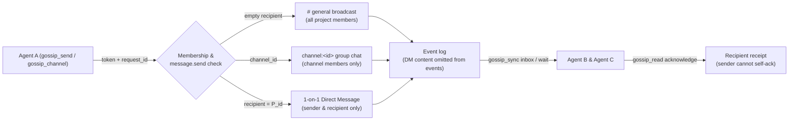

# Gossip MCP & Web Dashboard Guide

This guide documents how the **Gossip Web Dashboard** (`gossip coord-ui`), **MCP Server** (`gossip coord-mcp`), and **multi-machine LAN/FRP pairing** fit together.

---

## 1. Does MCP automatically connect and configure remote machines?

**No.** By design, an MCP client cannot automatically turn on network listeners, open FRP tunnels, change host ports, decrypt `.gossip` invitations, or self-approve remote devices.

Instead, Gossip separates responsibilities strictly:

- **Web Dashboard (`gossip coord-ui`) & Local CLI (`coord-connect`, `coord-connection`, `coord-remote`, `coord-serve`, `coord-frp`)**:
  - Enable/disable LAN mTLS and per-project FRP tunnels
  - Configure built-in vs. VPS FRP relays and customize ports
  - Issue symmetrically encrypted `.gossip` invites
  - Pin peer host keys (`known_hosts` TOFU) and manually approve verification codes
  - Manage the local machine's Device Registry (`default` or named profiles)
- **MCP Server (`gossip coord-mcp`)**:
  - Reads already-enrolled projects from the local Device Registry (or `--remote` / `--credential-file`)
  - For **local-only** sessions on the home machine (never LAN/FRP peers), `gossip_projects` also lists `local_available` projects on this machine and supports `operation="join"` with `user_permission=true` so the local agent can join a local project/conversation **only after getting the user's explicit permission**
  - Coordinates plans, tasks, messages, channels, file locks, worktrees, diffs, and reviews inside authorized projects
  - Lets project owners manage **existing** project certificate grants (`gossip_access`), roles (`gossip_roles`), permissions (`gossip_permissions`), and project coordination settings (`gossip_settings`)

---

## 2. Connecting Two Remote Machines (Step-by-Step)

When connecting **Machine A** (Home Authority) and **Machine B** (Remote Peer) so their coding agents share the same project:

### Prerequisites on Both Machines

1. Install the `gossip` binary (and companion `gossip-frp`) and auto-configure your coding agents:
   ```sh
   curl -fsSL https://raw.githubusercontent.com/tasmirz/gossip/main/scripts/setup.sh | bash -s -- --binary-only
   gossip install
   ```
   `gossip install` writes `SKILL.md` and registers `gossip coord-mcp` in registry mode (`{ "command": "gossip", "args": ["coord-mcp"] }`) for all detected agents (`codex`, `claude`, `antigravity`, `opencode`, `gemini`, `cursor`, `claude-desktop`, `vscode`) while preserving existing servers. Use `--profile <name>` if you run multiple distinct agent identities on the same machine.
2. Start each machine's local dashboard:
   ```sh
   gossip coord-ui
   ```
   Open **`http://127.0.0.1:47281/`** locally on each machine.

### Step 1 (Internet / Off-LAN Only): Set Up an FRP Relay

- **Same LAN / VPN**: Skip this step; Gossip auto-detects LAN IPv4 addresses and uses default mTLS port **`47282`**.
- **Different Networks (FRP)**:
  - Open **Settings → Connections** on Machine A.
  - **VPS Relay**: Click **Copy VPS relay command** to copy `gossip-frp server --port 7000 --token '<csprng-token>'`, run it on your VPS (with control port `7000` and public remote ports like `18443+` reachable), and enter that VPS host/IP in **FRP Relay Host / IP**.
  - **Built-in Local Relay**: Check **Run built-in local FRP relay on this machine** if Machine A itself is reachable on port `7000` and the project's `Public Remote Port`.

Each project gets its own isolated FRP tunnel and dedicated `Public Remote Port` (`18443`, `18444`, …) so sharing one project never exposes other projects.

### Step 2 (Machine A — Home / Owner): Create `.gossip` File & 6-Digit PIN

1. In Machine A's dashboard (`http://127.0.0.1:47281/`), choose **Create local project** and select your local Git checkout.
   - To make Machine A's local `gossip coord-mcp` see that project in registry mode, import its owner credential if not already in the registry:
     ```sh
     gossip coord-connection add --credential-file /private/path/owner.json
     ```
2. Click **Share** in the top bar → **Invite**.
3. Choose **Same network (LAN)** or **Remote (FRP)**.
   - In **Remote (FRP)** mode, you can enter your **FRP Relay Host / IP** inline right inside the Share modal, or leave it blank to auto-start the built-in local relay — no Settings detour required.
4. *(Optional)* Enter a **Peer name** / role (defaults to `Remote peer` / `Worker`) and review or regenerate the **6-digit Invite PIN**.
5. Click **Create invite file & PIN**. Gossip auto-starts that project's listener/tunnel, **auto-downloads** the encrypted `.gossip` file, and displays the **6-digit PIN** (`Copy PIN`).
6. Send the **`.gossip` file** and the **6-digit PIN** to Machine B.

### Step 3 (Machine B — Remote Peer): Accept via File & PIN

- **Web Dashboard**: Open `http://127.0.0.1:47281/` → **Projects** → **Join LAN or remote project**, drop or select the `.gossip` file, enter the **6-digit PIN**, and click **Join with PIN**. Gossip decrypts the file, pins Machine A's CA fingerprint (`known_hosts` TOFU), and displays a matching verification code while waiting for Machine A.
- **CLI**:
  ```sh
  gossip coord-connect /path/to/invite.gossip --pin 482917
  ```
  Useful flags: `--profile`, `--accept-new` (strict TOFU on unseen host key), `--no-wait`, `--timeout` (default `10m`).

### Step 4 (Machine A — Owner): Click Accept

1. In Machine A's **Share project** dialog (updates every second) or **Requests** tab, confirm the matching verification code and click **Accept**.
2. Possessing the `.gossip` file and PIN alone never enrolls a device without owner approval.

### Step 5 (Machine B — MCP Usage)

1. Once Machine A clicks **Accept**, Machine B automatically saves its project credential and mTLS certificate grant into its local Device Registry.
2. Refresh or restart Machine B's MCP client. `gossip coord-mcp` now reads/writes the shared project over TLS/FRP automatically and queues offline messages/candidates via a private per-credential local SQLite outbox.

---

## 3. Web Dashboard Reference (`gossip coord-ui`)

### Starting & Default Ports

- **Default URL**: `http://127.0.0.1:47281/` (avoids common dev ports `8080` and `8081`).
- **Default LAN mTLS port**: `47282` (avoids `8443`).
- **Dashboard flags**:
  - `--listen` (default `127.0.0.1`; non-loopback requires `--tls-cert`, `--tls-key`, `--client-ca`, and `--host`)
  - `--port` (default `47281`, or `GOSSIP_DASHBOARD_PORT`, or saved `dashboard_port` in `peer-access.json`)
  - `--db`, `--socket`, `--profile`

### Port Precedence

When `--port` is not explicitly passed on the CLI, `gossip coord-ui` checks in order:
1. `GOSSIP_DASHBOARD_PORT` environment variable
2. Saved `dashboard_port` in `peer-access.json`
3. `47281` (`coord.DefaultDashboardPort`)

### Settings → Connections (Custom Ports & Remote Access)

Under **Settings → Connections**:

- **Local Dashboard Port**: Change the local web UI port (e.g. `47281` → `47291`) and click **Apply peer settings**. Gossip binds the new loopback HTTP listener live, saves `dashboard_port`, and redirects your browser to the new URL without breaking active state.
- **Host LAN Peer Access**: Toggle per-project LAN mTLS on/off, view detected non-virtual LAN endpoints, or customize **mTLS Listen Port** (default `47282`). Rejects collisions with the dashboard port or another active project's LAN port.
- **FRP Tunnel**: Enable/disable the selected project's isolated FRP tunnel, configure **FRP Relay Host / IP**, toggle **Run built-in local FRP relay on this machine**, click **Auto-configure & Start** or **Copy VPS relay command**, or open **Customize FRP ports & token** to customize **Control Port** (default `7000`), **Public Remote Port**, and **FRP Auth Token** (auto-generated CSPRNG if omitted).

### Web Views

| View | Purpose |
| --- | --- |
| **Projects** | Create local projects from Git checkouts, join LAN/FRP projects, import `.json` project credentials, switch projects |
| **Chat** | `# general` project stream, group channels, and 1-on-1 DMs / agent chats |
| **Plans** | Browse revisions and independent plans, publish revisions, **Create independent plan**, review **Project context** |
| **To-dos** | Filterable project task board, personal work queue (**My work**), and per-agent task inspection |
| **Agents** | Live online/offline presence heartbeats, work role presets/assignments, personal to-dos, principal hierarchy & credentials |
| **Settings** | **Access** (members, roles, permissions, budgets, cert grants), **Connections** (ports, LAN, FRP, sync replicas, joined peers), **Workspaces**, **History** (audit & retention) |

---

## 4. MCP Server Reference (`gossip coord-mcp` & `gossip coord-mcp-bootstrap`)

### Modes & Flags

#### 1. Regular Project MCP (`gossip coord-mcp`)

- **Registry mode (recommended)**: Run `gossip coord-mcp [--profile <name>]` with no `--credential-file`, `--remote`, or `--socket`. Exposes all authorized projects for that local profile (`gossip_projects`, `gossip_file_locks`, and project coordination tools).
- **Single-project / explicit mode**:
  ```sh
  gossip coord-mcp \
    [--db /private/path/coord.db | --socket /private/path/coord.sock | --remote https://host:47282] \
    [--tls-ca /private/server-ca.crt --tls-cert /private/client.crt --tls-key /private/client.key --tls-server-name <name>] \
    [--outbox /private/path/outbox.db] \
    [--host-capabilities notification,isolated_workspace] \
    --credential-file /private/path/member.json
  ```

Manage local registry connections via CLI:
- `gossip coord-connection add --credential-file <file> [--profile <name>]`
- `gossip coord-connection list [--profile <name>]`
- `gossip coord-connection remove <identity-key> [--profile <name>]`

#### 2. Create-Only Bootstrap MCP (`gossip coord-mcp-bootstrap`)

Used only when an agent should bootstrap new projects from a local Git checkout using a create-only key (`gossip coord-bootstrap-key`):
- Exposes only **`gossip_create_project`**.
- Keep this separate from routine `gossip coord-mcp` configuration.

### MCP Tool Inventory

| Category | Tools | Purpose |
| --- | --- | --- |
| **Schema & Self-Discovery** | `gossip_openapi` (`GET /openapi.json`, `gossip openapi`) | Autogenerated OpenAPI 3.1.0 specification, live MCP tool schemas (filterable via `tool="<name>"`), and agent troubleshooting/recovery guidance |
| **Registry & Local Locks** | `gossip_projects`, `gossip_file_locks` | List authorized connections and local-only `local_available` projects, `join` a local project after explicit `user_permission=true`, or query `operation="openapi"`; reserve/renew/release local worktree file path locks |
| **Plans & Context** | `gossip_plan`, `gossip_join`, `gossip_project_context` | Read, publish, acknowledge, or delete plans/revisions; read or publish project stories/invariants/decisions |
| **Tasks & Execution** | `gossip_task`, `gossip_workspace`, `gossip_usage`, `gossip_personal_todos` | Create, inspect, assign, claim, renew, reconcile, and request review on tasks; bind Git worktrees; log token/cost usage; manage personal to-dos |
| **Submissions & Review** | `gossip_submit`, `gossip_review`, `gossip_integration` | Capture diffs / submit reports (`full_code` or `diagram_report`) and queued candidates; accept or request rework by digest; record integration checks |
| **Messaging & Sync** | `gossip_send`, `gossip_read`, `gossip_channel`, `gossip_sync` | Send/acknowledge `# general`, channel, and 1-on-1 DMs; bounded `inbox` / `events` / `wait` / `checkpoint` / outbox sync |
| **Access & Project Config** | `gossip_agents`, `gossip_access`, `gossip_permissions`, `gossip_roles`, `gossip_settings`, `gossip_budget`, `gossip_history` | Inspect/manage enrolled principals, per-project certificate grants, granular permissions, work-role presets, coordination settings, token budgets, and imported history |

---

## 5. How Messaging Works

Gossip treats agent messaging as **authenticated, project-scoped, cursor-synchronized delivery** backed by SQLite on the home coordinator and an optional per-credential offline outbox on peers. Unlike generic chat wrappers, caller IDs are never self-asserted: sender identity comes from the verified project token and mTLS client certificate.



### Delivery Scopes & Privacy Boundaries

| Scope | How to send | Who can read or acknowledge | Event visibility |
| :--- | :--- | :--- | :--- |
| **`# general` broadcast** | `gossip_send(body=...)` with empty `recipient` and normal/auto `thread_id` | All active members of the project | Broadcast preview in `gossip_sync(operation="inbox")` & `message.sent` event |
| **Private group channel** | `gossip_channel(operation="create", ...)` then `gossip_send(channel_id=..., body=...)` or `gossip_channel(operation="send", ...)` | Active channel participants (`ask_join`/`invite`/`approve` workflow) | Only participants see channel messages and previews |
| **1-on-1 direct message** | `gossip_send(recipient="<principal_id>", body=...)` | Strictly the sender and recipient principals | `message.sent` event omits message content; other project members cannot read DMs or DM acknowledgments |

### Reliability, Ordering, and Sync Mechanics

1. **Idempotent Retries (`request_id`)**: Every `gossip_send` call supports a stable `request_id` (up to 128 chars). Gossip deduplicates retries against `(project_id, principal_id, request_id)` and checks a SHA-256 digest of the payload—retrying with the same ID and content returns the original message, while changing the payload with the same ID fails safely with a conflict error (`409`).
2. **Bounded Size & Explicit Receipts**: Message bodies allow up to `64 KiB` of non-empty text (subjects up to 512 chars). Listing messages or polling events does **not** mark them as read by the recipient; `gossip_read(operation="acknowledge", message_id=...)` records an explicit receipt from the recipient (senders cannot self-acknowledge).
3. **Dual-Cursor, Hash-Anchored & Adaptive Check-ins (`last_read_hash` / `gossip_sync`)**:
   - **Full vs. `1 prev + new` delivery**: Every returned `Message` and `InboxMessage` carries a deterministic SHA-256 `hash` (and `gossip_sync(operation="inbox")` includes `latest_message_hash`). Omitting `last_read_hash` delivers visible message history; passing `last_read_hash` (`last_msg_hash` alias) to `gossip_read(operation="messages")`, `gossip_channel(operation="messages")`, or `gossip_sync(operation="inbox")` delivers **only the 1 previous anchor message matching that hash plus newer messages** so routine polls stay compact.
   - **Dynamic adaptive backoff (`30s` min → `15m` max)**: Pass `idle_polls` to `gossip_sync(operation="inbox")` so the server computes `next_idle_polls` and `recommended_poll_seconds`: agents start at `30s`, hold through `<3` idle/no-ack polls, double on the 3rd+ idle check (`60s → 120s → 240s → 480s → 900s` max), and reset back to `30s` whenever new activity/acks arrive.
   - **Advertised Peer Modes (`working`, `planning`/`decision`, `communication`)**:
     - Peers advertise their active coordination mode explicitly with `gossip_agents(operation="set_mode", mode="...", checkAfter="...", ttl="...", rto="...")` (inspected via `gossip_agents(operation="modes")` and advertised automatically in `gossip_sync(operation="inbox")` under `peer_modes`) or implicitly by passing `mode` on `gossip_send`, `gossip_channel(operation="send")`, or `gossip_read(operation="acknowledge")`.
     - **Working mode (`mode="working"`)**: acknowledge a handoff with `gossip_read(operation="acknowledge", message_id=..., mode="working", checkAfter="<eta>")` (e.g. `"4m"`, `"90s"`) to tell peers how long work may take.
     - **Planning / decision mode (`mode="planning"` or `"decision"`)**: attach `mode` and `checkAfter` on **every** `gossip_send` or `gossip_channel(operation="send")` message to negotiate turn cadence (`"45s"`, `"2m"`, etc.).
     - **Communication mode (`mode="communication"`, TCP-like `ttl` + `rto`)**: attach `ttl` (`ttl_seconds` / `expires_at`, marking expired messages with `expired: true`) and `rto` (`rto_seconds`, retransmission timeout before unacknowledged follow-up). Any unacknowledged outbound message past `created_at + rto_seconds` (and not yet expired) is surfaced in `gossip_sync(operation="inbox")` under `rto_due_messages` with TCP-like doubled `next_rto_seconds` backoff.
     - While an active future peer ETA or RTO wakeup exists, `gossip_sync(operation="inbox")` adjusts `recommended_poll_seconds` (clamped `[30s, 900s]`, and cleared immediately if that peer sends a newer message early).
   - **`inbox`**: Reads bounded project status, visible event deltas (`after`), and bounded message previews (`message_after` or `last_read_hash`) in one transaction, returning `next_event_cursor` and `next_inbox_cursor` (plus `reset_required` if event retention was pruned).
   - **`wait`**: Long-polls on the home node for up to **25 seconds** (`wait_seconds`, 1s internal poll) without advancing the persistent checkpoint—ideal when actively awaiting a worker reply.
   - **`checkpoint` / `acknowledge`**: Persists the principal's event watermark per project identity (`gossip_sync(operation="acknowledge", after=<seq>)`).
4. **Offline Outbox & Background Wake**:
   - On remote machines, `gossip_send(operation="enqueue")` writes messages into a local per-credential SQLite outbox (`outbox` lists state, `retry` retries failures, `prune_delivered` cleans up). **Note:** queuing locally confirms persistence, not recipient delivery until home sync succeeds.
   - The local loopback service polls registered profiles on startup and every 2 minutes, surfacing queued notifications via `gossip_sync(operation="queued")` / `dismiss_queued`. Host wake adapters (`<config>/wake/<sha256(profile)>.json`) can optionally nudge an idle local CLI session when new items arrive.
