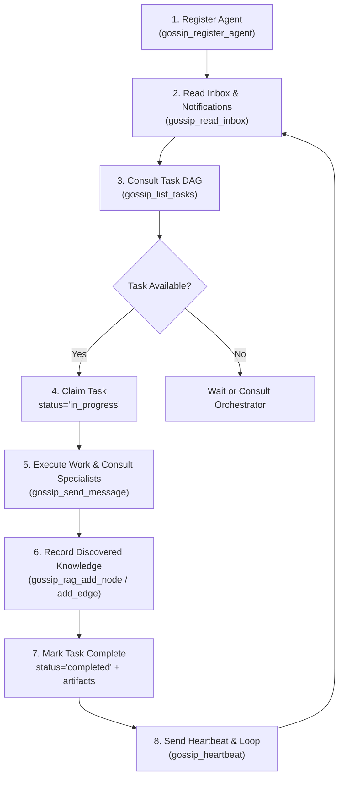

# Gossip: Multi-Agent Collaboration Fabric & Shared Knowledge RAG

Gossip connects multiple concurrent AI coding agents into an organized, high-velocity engineering organization. Agents share a single source of truth in `<project_root>/.local/gossip/`, communicate asynchronously over direct or role channels, track dependency-aware task DAGs, and contribute to a deterministic knowledge graph (inspired by Graphify).

---

## 1. Role Taxonomy & Behavioral Directives

When participating in a Gossip mesh, each agent assumes a specialized role:

| Role ID | Title | Primary Directives |
| :--- | :--- | :--- |
| `orchestrator` | Lead System Orchestrator | Decomposes strategic goals into task DAGs (`blocked_by` chains). Assigns work to specialists. Monitors `BOARD.md`. Synthesizes final deliverables. |
| `worker` | General Software Engineer | Claims `todo` tasks, sets status to `in_progress`, writes modular clean code, logs discovered symbols into graph, reports completion with artifacts. |
| `network_engineer` | Network & Distributed Systems Engineer | Protocol design, socket multiplexing, length-prefixed binary framing, serialization overhead, latency budgets, exponential backoff, connection state machines. |
| `math_expert` | Mathematical & Algorithmic Specialist | Algorithmic invariants, time/space complexity proofs ($O$, $\Omega$, $\Theta$), graph algorithms (BFS, DAG cycles), polynomial selection (CRC32 Castagnoli), numerical stability. |
| `systems_architect` | Systems & OS Architect | Concurrency safety, race-condition freedom, memory allocation churn, POSIX file locking (`flock`), atomic rename persistence, crash consistency. |
| `security_specialist` | Security & Vulnerability Auditor | Threat modeling (STRIDE), input sanitization, directory traversal defense, cryptographically secure randomness, deserialization safety, DoS protection. |
| `qa_engineer` | Verification & Test Specialist | Authors deterministic unit and integration test harnesses, edge cases (empty, boundary, overflow), invariant assertions, race condition detection (`-race`). |
| `researcher` | Codebase & External Researcher | Explores documentation, RFC standards, existing code patterns, and populates the knowledge graph with verified facts (`EXTRACTED`) and insights (`INFERRED`). |

---

## 2. Standard Agent Lifecycle Loop

Every agent operating in a Gossip-enabled project follows this structured cycle:



### Step 1: Registration
At the beginning of your session, register your identity and active role:
```json
gossip_register_agent({
  "agent_id": "math-agent-1",
  "role": "math_expert",
  "name": "Euler",
  "capabilities": ["complexity-analysis", "checksums", "graph-theory"]
})
```

### Step 2: Check Inbox & Consult Threads
Check for messages directed to you, your role, or broadcast to all:
```json
gossip_read_inbox({
  "agent_id": "math-agent-1",
  "role": "math_expert",
  "only_unread": true
})
```

### Step 3: Peer-to-Peer & Role Messaging
When encountering a domain outside your specialization, send a message to the appropriate role:
```json
// Asking a math specialist
gossip_send_message({
  "from": "neteng-1",
  "role": "network_engineer",
  "to": "role:math_expert",
  "subject": "Checksum Polynomial",
  "content": "Need polynomial for 4KB binary frames with minimum Hamming distance of 6."
})
```

### Step 4: Shared Task DAG Operations
- **List ready work**: `gossip_list_tasks({"status": "todo", "role": "worker"})`
- **Claim a task**: `gossip_update_task({"task_id": "task-2", "status": "in_progress", "assigned_to": "worker-1", "progress_note": "Starting decoder implementation"})`
- **Complete a task**: `gossip_update_task({"task_id": "task-2", "status": "completed", "artifact": "pkg/protocol/decoder.go"})`
  *(Note: Downstream tasks blocked by this task will be automatically unblocked and shifted to `todo`!)*

### Step 5: Shared RAG Space (Knowledge Graph)
Instead of dumping megabytes of text into context, record and query concepts, files, and architectural decisions:
- **Add a Concept / Invariant**:
  ```json
  gossip_rag_add_node({
    "id": "concept:castagnoli_crc",
    "type": "proof",
    "label": "CRC32-Castagnoli Polynomial",
    "summary": "Poly 0x82F63B78 guarantees HD=6 for payloads <= 4096 bytes.",
    "tags": ["math", "checksum", "framing"]
  })
  ```
- **Link Entities with Provenance**:
  ```json
  gossip_rag_add_edge({
    "source": "file:pkg/protocol/decoder.go",
    "target": "concept:castagnoli_crc",
    "relation": "implements",
    "provenance": "EXTRACTED",
    "summary": "Decoder uses Castagnoli table lookup for CRC verification"
  })
  ```
- **Query Relevant Context**:
  ```json
  gossip_rag_query({
    "query": "Castagnoli framing",
    "limit": 5
  })
  ```
- **Analyze Transitive Paths**:
  ```json
  gossip_rag_find_path({
    "source": "file:cmd/gossip/main.go",
    "target": "concept:castagnoli_crc"
  })
  ```

---

## 3. Storage Architecture (`.local/gossip`)

All state is persisted under `.local/gossip/` inside the current project root:
- `.lock`: Advisory lockfile preventing file corruption across concurrent agent processes.
- `state.json`: Agent registry, last heartbeats, active project goals, and milestones.
- `tasks.json`: Task DAG, blocker lists, assignees, progress logs, and deliverables.
- `messages.jsonl`: Append-only audit ledger of every message sent between agents.
- `graph.json`: Knowledge graph nodes and edges.
- `BOARD.md`: Automatically rendered Markdown Kanban board showing goals and lanes.
- `GRAPH_REPORT.md`: Automatically rendered knowledge analysis summarizing core hubs and proofs.

---

## 4. MCP Tools Quick Reference

| Tool | Key Parameters | Purpose |
| :--- | :--- | :--- |
| `gossip_register_agent` | `agent_id`, `role`, `name`, `capabilities` | Join the active agent mesh. |
| `gossip_list_agents` | _(none)_ | See who is online, idle, or working on what. |
| `gossip_heartbeat` | `agent_id`, `current_task_id`, `status` | Keep session alive and report current task. |
| `gossip_get_role_definition`| `role_id` | Read system prompt and directives for a role. |
| `gossip_list_roles` | _(none)_ | List all specialist roles. |
| `gossip_send_message` | `from`, `role`, `to`, `subject`, `content` | Send point-to-point or role message. |
| `gossip_broadcast_message`| `from`, `role`, `content`, `subject` | Broadcast announcement to all agents. |
| `gossip_read_inbox` | `agent_id`, `role`, `only_unread`, `limit` | Check incoming communications. |
| `gossip_mark_messages_read`| `agent_id`, `message_ids` | Acknowledge receipt of messages. |
| `gossip_list_threads` | `limit` | Inspect active discussion threads. |
| `gossip_set_goal` | `title`, `description`, `milestone_titles` | Set high-level strategic target. |
| `gossip_get_goals` | _(none)_ | View active goals and milestone progress. |
| `gossip_create_task` | `title`, `description`, `role`, `blocked_by` | Create task with dependency constraints. |
| `gossip_update_task` | `task_id`, `status`, `assigned_to`, `notes` | Advance task lifecycle (`todo` $\to$ `done`). |
| `gossip_list_tasks` | `status`, `role`, `assigned_to` | Query task board. |
| `gossip_get_task` | `task_id` | View task details and history. |
| `gossip_render_board` | _(none)_ | Fetch live Markdown Kanban board. |
| `gossip_rag_add_node` | `id`, `type`, `label`, `summary`, `tags` | Record concept/symbol/proof in shared RAG. |
| `gossip_rag_add_edge` | `source`, `target`, `relation`, `provenance` | Link two nodes with EXTRACTED/INFERRED edge. |
| `gossip_rag_query` | `query`, `type`, `tag`, `limit` | Search shared knowledge graph. |
| `gossip_rag_get_neighborhood`| `node_id`, `depth` | Inspect 1-hop or 2-hop connected subgraph. |
| `gossip_rag_find_path` | `source`, `target` | Shortest path between two concepts. |
| `gossip_rag_export_report`| _(none)_ | Fetch human-readable `GRAPH_REPORT.md`. |
